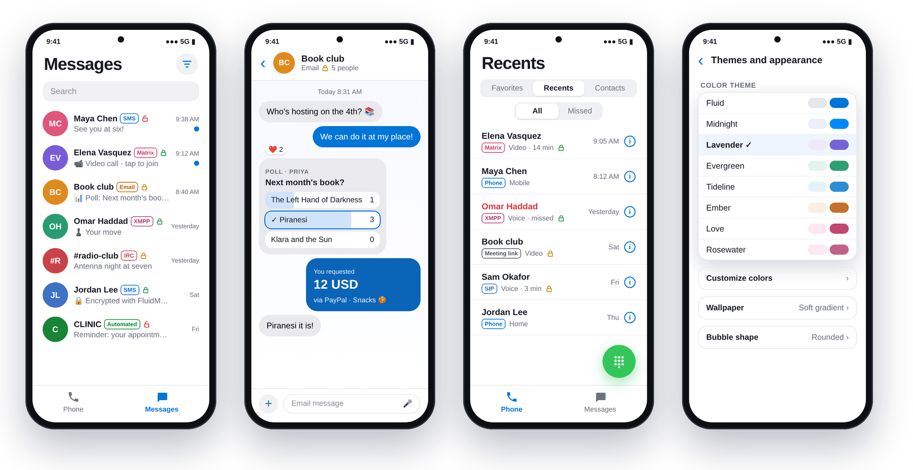

<div align="center">


# FluidMessages

**Your texts, calls, and chats in one private, beautiful app.**

SMS · MMS · Matrix · XMPP · Email · IRC · Calls &nbsp;—&nbsp; open source for Android, with a web version you host yourself.

<a href="https://github.com/Lin8x/FluidMessages/releases/latest"></a>
<a href="LICENSE"></a>

<a href="docs/self-hosting.md"></a>
<a href="https://lin8x.github.io/FluidMessages/"></a>

[**Download**](https://github.com/Lin8x/FluidMessages/releases/latest) · [Website](https://lin8x.github.io/FluidMessages/) · [Features](docs/features.md) · [Self-hosting](docs/self-hosting.md) · [Contributing](CONTRIBUTING.md)

<br>



<sub>Android screens are illustrations made from fictional data. Web screenshots below are real captures of FluidMessages Web.</sub>

</div>

---

<details>
<summary><strong>Table of contents</strong></summary>

- [Why FluidMessages](#why-fluidmessages)
- [Features](#features)
- [Download](#download)
- [Quick start: Android](#quick-start-android)
- [Quick start: FluidMessages Web (Docker)](#quick-start-fluidmessages-web-docker)
- [Documentation](#documentation)
- [Privacy](#privacy)
- [Contributing](#contributing)
- [License](#license)

</details>

## Why FluidMessages

Your conversations are scattered: texts in one app, Matrix in another, email somewhere else, calls in a fourth. FluidMessages puts them in **one inbox and one Phone tab**, without asking you to trust a company with them.

- **One app for everything.** Texts and group texts sit next to Matrix, XMPP, Email, and IRC, each with a small tag so you always know how a message travels.
- **Private by design.** No ads, no analytics, no account with us. A lock on every chat shows who can read it.
- **Works with everyone.** Polls, events, money requests, and games are readable text underneath, so friends on other apps can still take part.
- **Yours to run.** The web version runs on your own server, from a single Docker container.

## Features

<table>
<tr>
<td width="50%" valign="top">

### One inbox for every service

Texts, group texts, Matrix, XMPP, Email, and IRC side by side. Replies, reactions, photos, files, voice messages, locations, and money requests work on every service. Add accounts in **Settings → Chats and calls → Accounts**.

</td>
<td width="50%" valign="top">

### Calls built in

A Phone tab laid out like the iPhone's, with Favorites, Recents, Contacts, and a keypad. Phone calls, end-to-end encrypted Matrix and XMPP calls, SIP, and meeting links anyone can join. Calls can be recorded to a folder you choose.

</td>
</tr>
</table>

### More than text

Polls, shareable calendar events, games, meeting links, and money requests show up as rich cards. Underneath, each one is plain text, so people on other apps still see something that makes sense and can reply.

- **Formatting, spoilers, edits, and effects:** `*bold*`, `||spoilers||`, editing sent messages, and effects like Slam, Invisible ink, and Confetti. Other apps get readable text.
- **RSVP, dice, and contact cards:** answer events with Going, Maybe, or Can't go; roll dice, flip a coin, or pick at random; and share contacts as cards.
- **Voice message transcripts:** made on your phone, never in the cloud.
- **Games:** chess, tic-tac-toe, four in a row, and rock paper scissors, or a game link on Lichess, Chess.com, Foony, or Papergames. Tap the board to play. Friends on other apps get the board as text and play by replying with their move, like `e5` or `7`.
- **Photo editor:** crop, rotate, adjust light and color, filters, drawing, text in eight fonts, layered photos and stickers, and resizing, then send straight from the editor.

<p align="center">
  
</p>

Also included: GIFs and stickers from your keyboard or built-in GIF sites, link previews for videos and songs, and money requests by Monero, Bitcoin, Lightning, USDC, PayPal, Venmo, Cash App, Revolut, UPI, bank transfer, and your own payment links. FluidMessages never holds money or keys. [Details →](docs/features.md#gifs-stickers-polls-events-games-and-link-previews)

### Make it yours

Eight color themes, each with light and dark versions, plus custom colors, wallpapers, bubble shapes, motion, and sounds. A sample inbox with pretend chats lets you try everything before you switch.

<p align="center">
  
</p>

### On every screen

<table>
<tr>
<td width="62%" valign="top">

</td>
<td width="38%" valign="top">

**FluidMessages Web** is the web version, like WhatsApp Web, running on a server you control.

- Keeps your Matrix, XMPP, Email, and IRC connections open, so your phone doesn't have to.
- Shows the texts your phone syncs and sends texts through your phone.
- Works in any browser, as an installable app (PWA), or as a desktop app for Windows, macOS, and Linux.
- Light and dark mode follow your phone's appearance.

</td>
</tr>
</table>

<details>
<summary>More screenshots</summary>
<br>
<p align="center">
  
</p>
<p align="center">
  
</p>
</details>

### Backups you control

Encrypted backups to your phone, your own server (SFTP, WebDAV such as Nextcloud, FTPS, or FTP, on any port), or OneDrive, Google Drive, and S3, on a schedule or whenever you like. [Details →](docs/features.md#backups)

## Download

| Platform | Download | Notes |
|---|---|---|
| **Android** 13 or newer | [`FluidMessages-<version>.apk`](https://github.com/Lin8x/FluidMessages/releases/latest) | Open the file on your phone to install. Updates are offered in the app. |
| **Windows** | [`FluidMessages-Web-<version>-Windows.exe`](https://github.com/Lin8x/FluidMessages/releases/latest) | FluidMessages Web as a desktop app. |
| **macOS** | [`FluidMessages-Web-<version>-macOS.dmg`](https://github.com/Lin8x/FluidMessages/releases/latest) | FluidMessages Web as a desktop app. |
| **Linux** | [`FluidMessages-Web-<version>-Linux-x86_64.AppImage`](https://github.com/Lin8x/FluidMessages/releases/latest) | Make it executable, then open it. |
| **Server** | `ghcr.io/lin8x/fluidmessages-web` | For Docker, Docker Compose, or Portainer. See [Self-hosting](docs/self-hosting.md). |

Everything is on the [Releases page](https://github.com/Lin8x/FluidMessages/releases/latest). The desktop apps aren't code-signed yet; see [Desktop apps](docs/self-hosting.md#desktop-apps) if your computer warns you.

## Quick start: Android

1. **Install.** Download the APK on your phone and open it. Android may ask you to allow installs from your browser or files app.
2. **Set up.** The setup guide walks you through colors, privacy, and the services you use. **Practice first** opens a sample inbox with pretend chats and calls.
3. **Make it your texting app.** In your inbox, tap **Set as default SMS app**.
   > On Android 15, Android may block this for apps installed from a file. Go to **App info → ⋮ → Allow restricted settings**, then try again.
4. **Add more services** (optional): Matrix, XMPP, Email, or IRC in **Settings → Chats and calls → Accounts**.

## Quick start: FluidMessages Web (Docker)

From a copy of this repository:

```sh
umask 077
printf 'FLUID_TOKEN=%s\n' "$(openssl rand -hex 32)" > .env
docker compose up -d
```

Open <http://localhost:8080> and sign in with the token from `.env`. To connect your phone, put FluidMessages Web behind HTTPS, then open **Settings → FluidMessages Web** on the phone.

It runs on x86-64 and ARM64 Docker hosts, including a Raspberry Pi. The [Self-hosting guide](docs/self-hosting.md) covers [Docker Compose](docs/self-hosting.md#docker-compose), [Portainer](docs/self-hosting.md#portainer), [HTTPS and pairing your phone](docs/self-hosting.md#https-and-connecting-your-phone), the [desktop apps](docs/self-hosting.md#desktop-apps), and [installing it as an app](docs/self-hosting.md#install-it-as-an-app-pwa).

## Documentation

| Guide | What's inside |
|---|---|
| [Features](docs/features.md) | Everything the app can do, in detail. |
| [Self-hosting](docs/self-hosting.md) | Docker, Docker Compose, Portainer, HTTPS, the desktop apps, and the PWA. |
| [Development](docs/development.md) | Building, testing on the emulator, local checks, and releasing. |
| [Contributing](CONTRIBUTING.md) | How to help. |

## Privacy

FluidMessages has no ads, analytics, or accounts with us. Your messages stay on your phone and on the server you run.

<p align="center">
  
</p>

- **Calls:** Matrix and XMPP calls are end-to-end encrypted. Meeting links and SIP calls show a yellow lock, because the meeting server or SIP provider can see them.
- **Texts:** regular texts are only encrypted when both people use FluidMessages encryption.
- **On your phone:** stored messages, accounts, and the pairing token are encrypted with a key held by Android Keystore.

See [Privacy and security](docs/features.md#privacy-and-security) for the details.

## Contributing

Bug reports, ideas, and pull requests are welcome. Start with [CONTRIBUTING.md](CONTRIBUTING.md), then see [Development](docs/development.md) for building and testing. Found a problem? [Open an issue](https://github.com/Lin8x/FluidMessages/issues).

## License

FluidMessages is open source under the [Apache License 2.0](LICENSE).
