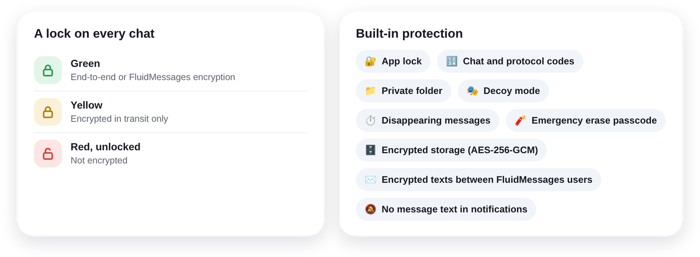
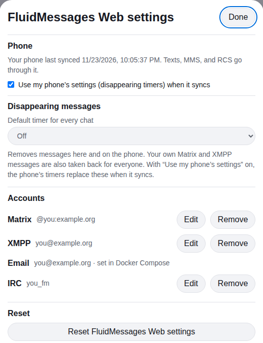

<div align="center">


# FluidMessages

**Your texts, calls, and chats in one private app.**

<a href="https://github.com/Lin8x/FluidMessages/releases/latest"></a> <a href="https://github.com/Lin8x/FluidMessages/releases"></a> <a href="LICENSE"></a> <a href="https://github.com/Lin8x/FluidMessages/stargazers"></a>

    <a href="docs/self-hosting.md"></a>    

<br>

<a href="https://github.com/Lin8x/FluidMessages/releases/latest"></a> <a href="https://github.com/Lin8x/FluidMessages/releases/latest"></a> <a href="#-host-it-yourself"></a>

<br><br>



</div>

<br>

<details>
<summary><b>📑 Contents</b></summary>

- [Why FluidMessages](#-why-fluidmessages)
- [Privacy](#-privacy)
- [Features](#-features)
- [Download](#-download)
- [Get started on Android](#-get-started-on-android)
- [Host it yourself](#-host-it-yourself)
- [Docs](#-docs)
- [Contributing](#-contributing)
- [License](#-license)

</details>

## 💚 Why FluidMessages

<table>
<tr>
<td align="center" width="25%">💬<br><b>One inbox</b><br><sub>Texts, Matrix, XMPP, Email, and IRC together.</sub></td>
<td align="center" width="25%">🔒<br><b>Private</b><br><sub>No ads, no tracking, no account with us.</sub></td>
<td align="center" width="25%">🤝<br><b>Works with everyone</b><br><sub>Friends on other apps can still join in.</sub></td>
<td align="center" width="25%">🏠<br><b>Yours to run</b><br><sub>Host the web version on your own server.</sub></td>
</tr>
</table>

## 🔒 Privacy

Your messages stay on your phone and on the server you run. Nobody else gets a copy.

<p align="center">
  
</p>

| | |
|---|---|
| 🟢 **A lock on every chat** | Green means only you and they can read it. Yellow means a server can too. |
| 📞 **Encrypted calls** | Matrix and XMPP calls are end-to-end encrypted. |
| ✉️ **Encrypted texts** | Texts are encrypted when you both use FluidMessages. |
| 📱 **Locked down on your phone** | App lock, chat locks, a private folder, decoy mode, disappearing messages, and an emergency erase code. |

[Read more about privacy →](docs/features.md#privacy-and-security)

## ✨ Features

<table>
<tr>
<td align="center" width="33%">💬<br><b>Every chat app in one</b><br><sub>SMS, MMS, Matrix, XMPP, Email, IRC</sub></td>
<td align="center" width="33%">📞<br><b>Calls built in</b><br><sub>Phone, Matrix, XMPP, SIP, meeting links</sub></td>
<td align="center" width="33%">🎮<br><b>Games</b><br><sub>Chess, tic-tac-toe, four in a row, rock paper scissors</sub></td>
</tr>
<tr>
<td align="center">📊<br><b>Polls and events</b><br><sub>Vote, RSVP, add to your calendar</sub></td>
<td align="center">🖼️<br><b>Photo editor</b><br><sub>Crop, filters, drawing, text, stickers</sub></td>
<td align="center">🎉<br><b>Effects</b><br><sub>Confetti, Slam, Invisible ink, and more</sub></td>
</tr>
<tr>
<td align="center">💸<br><b>Money requests</b><br><sub>Monero, Bitcoin, PayPal, and more</sub></td>
<td align="center">🎨<br><b>Themes</b><br><sub>8 themes, wallpapers, bubbles, sounds</sub></td>
<td align="center">💾<br><b>Encrypted backups</b><br><sub>To your phone, your server, or the cloud</sub></td>
</tr>
</table>

### 💬 Rich cards that work everywhere

Polls, events, games, and payments show up as cards. Underneath they're plain text, so people on other apps can read and reply too.

<p align="center">
  
</p>

- **Games:** tap the board to play. Friends without the app just reply with a move, like `e5`.
- **Fun extras:** spoilers, `*bold*` text, edits, dice, coin flips, and message effects.
- **Voice notes:** get a transcript made on your phone, never in the cloud.

### 🎨 Make it yours

Eight color themes, each in light and dark. Try them all in a sample inbox before you switch.

<p align="center">
  
</p>

### 💻 On every screen

Use it on your phone, in any browser, or as a desktop app.

<p align="center">
  
</p>

<details>
<summary><b>📸 More screenshots</b></summary>
<br>
<p align="center">
  
  <br><br>
  
</p>
<sub>The Android screens are illustrations made with fictional data. Web screenshots are real captures, also with fictional data.</sub>
</details>

[See every feature →](docs/features.md)

## 📥 Download

<p align="center">
  <a href="https://github.com/Lin8x/FluidMessages/releases/latest"></a> <a href="https://github.com/Lin8x/FluidMessages/releases/latest"></a> <a href="#-host-it-yourself"></a>
</p>

| | Get | Good to know |
|---|---|---|
| 🤖 **Android 13+** | [`.apk`](https://github.com/Lin8x/FluidMessages/releases/latest) | The app offers updates for you. |
| 🪟 **Windows** | [`.exe`](https://github.com/Lin8x/FluidMessages/releases/latest) | The web version as a desktop app. |
| 🍎 **macOS** | [`.dmg`](https://github.com/Lin8x/FluidMessages/releases/latest) | The web version as a desktop app. |
| 🐧 **Linux** | [`.AppImage`](https://github.com/Lin8x/FluidMessages/releases/latest) | Make it executable, then open it. |
| 🐳 **Server** | `ghcr.io/lin8x/fluidmessages-web` | For Docker or Portainer. |

> [!NOTE]
> The desktop apps aren't code-signed yet, so your computer may warn you. [Here's what to do.](docs/self-hosting.md#desktop-apps)

## 🚀 Get started on Android

1. **Install.** Open the `.apk` on your phone.
2. **Set up.** Pick your colors and services. Tap **Practice first** to try a pretend inbox.
3. **Make it your texting app.** Tap **Set as default SMS app**.

> [!TIP]
> On Android 15, if that's blocked, go to **App info → ⋮ → Allow restricted settings** and try again.

Want Matrix, XMPP, Email, or IRC? Add them in **Settings → Accounts and calls → Accounts**.

## 🏠 Host it yourself

FluidMessages Web is FluidMessages as an app for your computer: Matrix, XMPP, Email, and IRC chats, calls, themes, effects, polls, and games. **No phone needed.** It runs anywhere Docker does, even a Raspberry Pi.

```sh
docker compose up -d
```

Open <http://localhost:8080>. On that computer it opens straight into a short welcome, with no password or code. Prefer an app? Use the [desktop app](https://github.com/Lin8x/FluidMessages/releases/latest) instead.

> [!TIP]
> Want your texts there too, or to use it from other devices? Open **Settings → Phone and other devices**. It walks you through setting a password and connecting your Android phone.

[Full self-hosting guide →](docs/self-hosting.md) (HTTPS, Portainer, connecting your phone, and installing it as an app)

## 📚 Docs

| | |
|---|---|
| 📖 [Features](docs/features.md) | Everything the app can do. |
| 🏠 [Self-hosting](docs/self-hosting.md) | Docker, Portainer, HTTPS, and desktop apps. |
| 🛠️ [Development](docs/development.md) | Building, testing, and releasing. |
| 🤝 [Contributing](CONTRIBUTING.md) | How to help. |

## 🤝 Contributing

Everyone is welcome, and you don't have to write code to help.

| | |
|---|---|
| 🐛 **Report a bug** | [Open an issue](https://github.com/Lin8x/FluidMessages/issues/new) with what you did and what happened. |
| 💡 **Suggest an idea** | [Open an issue](https://github.com/Lin8x/FluidMessages/issues/new) and tell us what you'd like. |
| 📱 **Test on your phone** | Try new releases and tell us what works on your phone and carrier. |
| 🧑‍💻 **Write code** | Fix a bug or build a feature, then open a pull request. |

**Code in four steps:**

1. Fork the repo and clone it.
2. Build the app: `./gradlew assembleDebug` (needs JDK 17 and Android SDK 35).
3. Run the checks: `./scripts/test-local`.
4. Open a pull request. For screen changes, add a screenshot.

Please use made-up names and messages in screenshots and tests. Read [CONTRIBUTING.md](CONTRIBUTING.md) for the full guide.

## 📄 License

FluidMessages is free and open source under the [Apache License 2.0](LICENSE).

<div align="center">
<br>
<br>
<sub>Made with 💚 for people who want their messages back.</sub>
</div>
