<div align="center">


# FluidMessages

**All your texts and chats in one free, private app,<br>on your phone and on your computer.**

<a href="https://github.com/Lin8x/FluidMessages/releases/latest"></a> <a href="https://github.com/Lin8x/FluidMessages/releases"></a> <a href="LICENSE"></a> 

<br>

<a href="https://github.com/Lin8x/FluidMessages/releases/latest/download/FluidMessages.apk"></a> <a href="#-get-it"></a>

</div>

<br>

<p align="center">
  
</p>

Most of us juggle a lot of messaging apps. Texts live in one place, the family group in another, work somewhere else, and that club you joined in yet another app. You switch between them all day, and every one of them sends you notifications.

<p align="center">
  
</p>

**FluidMessages is one app for all of it.** It's your phone's texting app, and it can also bring in your other chats, so everything is in one inbox. A small tag on each conversation tells you where it came from. You reply from the same place, and it looks and works the same everywhere.

It's **free**, it has **no ads**, and it **doesn't watch what you do**. There's no FluidMessages account to make and no company reading your messages.

<br>

---

<br>

## 🙋 Who is it for?

<table>
<tr>
<td width="50%" valign="top">

### 📱 If you have an Android phone

FluidMessages becomes your texting app, so it replaces the app you text with today. Your old texts stay right where they are. You get everything on this page.

</td>
<td width="50%" valign="top">

### 💻 If you have an iPhone or a computer

You can use FluidMessages on a computer for your other chats, like work or club chats. iPhones only let Apple's own Messages app send texts, so texting needs an Android phone.

</td>
</tr>
</table>

<br>

---

<br>

## 💙💚 Blue bubbles, green bubbles, and why this exists

If you have an iPhone, you know this: messages to other iPhones are **blue**, and messages to anyone with an Android phone turn **green**. Green means a plain, old-style text message. Fun things like hearts on messages arrive as clumsy sentences, such as *Loved "Yes! 7 o'clock?"*.

On Android, FluidMessages is the app that sends your texts. It turns those clumsy sentences back into real hearts, and it adds polls, plans, and games right inside the chat. Friends with any other app can still read and reply.

<p align="center">
  
</p>

<br>

---

<br>

## ✨ What you can do with it

<table>
<tr>
<td align="center" width="33%">❤️<br><b>React with a heart</b><br><sub>Tap and hold a message to send a ❤️, 👍 or 😆, with a little animation.</sub></td>
<td align="center" width="33%">↩️<br><b>Reply to one message</b><br><sub>In a busy group, answer the exact message you mean so nobody gets confused.</sub></td>
<td align="center" width="33%">📊<br><b>Polls and plans</b><br><sub>Ask "which day works?" and watch the votes come in. Plan an event and see who's coming.</sub></td>
</tr>
<tr>
<td align="center">🎮<br><b>Games in the chat</b><br><sub>Play chess, tic-tac-toe, and more, one move at a time.</sub></td>
<td align="center">🤫<br><b>Hidden messages</b><br><sub>Send a message that stays blurred until your friend taps it.</sub></td>
<td align="center">🎉<br><b>Fun effects</b><br><sub>Send a message with confetti, hearts, or a big slam.</sub></td>
</tr>
<tr>
<td align="center">👥<br><b>Join communities</b><br><sub>Big public groups with many chat rooms, like a club with lots of topics.</sub></td>
<td align="center">🔕<br><b>Quiet a chat</b><br><sub>Mute a person or group for an hour, a day, or for good.</sub></td>
<td align="center">🎨<br><b>Make it yours</b><br><sub>Eight color themes, wallpapers, and sounds.</sub></td>
</tr>
</table>

<p align="center">
  
</p>

**On your computer too.** Connect your phone, and your messages show up in your computer's web browser or in the desktop app, so you can type on a real keyboard. Changes on one show up on the other.

<p align="center">
  
</p>

<details>
<summary><b>📸 See real screenshots</b></summary>
<br>
<p align="center">
  
  <br><br>
  
  <br><br>
  
  <br><br>
  
</p>
<sub>Android screens are illustrations. Computer screenshots are real captures. Everything uses made-up names.</sub>
</details>

[See everything it can do →](docs/features.md)

<br>

---

<br>

## 🔒 Private, and you can see it

Every conversation shows a small lock so you always know who could read it.

<p align="center">
  
</p>

You can also lock the whole app, put private chats in a hidden folder, and make messages disappear after a while.

**What FluidMessages never does:** show ads, track you, or ask you to make an account with us.

<br>

---

<br>

## 📥 Get it

### 📱 On an Android phone

<p align="center">
  <a href="https://github.com/Lin8x/FluidMessages/releases/latest/download/FluidMessages.apk"></a>
</p>

<p align="center">
  
</p>

1. **Download** it with the button above, on your phone. It needs Android 13 or newer.
2. **Install** it: open the downloaded file, then tap **Install**. Your phone may ask you to allow installing apps from your browser. That's expected for apps that aren't from the Play Store.
3. **Set it up:** pick your colors, try the practice inbox if you like, then tap **Set as default SMS app** so FluidMessages sends your texts.

> [!TIP]
> On Android 15, if setting it as your texting app is blocked, go to **Settings → Apps → FluidMessages → ⋮ → Allow restricted settings** and try again.

The app tells you when there's an update.

### 💻 On a computer

| Your computer | Download | Good to know |
|---|---|---|
| 🪟 **Windows** | [Windows app](https://github.com/Lin8x/FluidMessages/releases/latest/download/FluidMessages-Web-Windows.exe) | Windows may warn you the first time. [Here's why, and what to do.](docs/self-hosting.md#desktop-apps) |
| 🍎 **Mac** | [Mac app](https://github.com/Lin8x/FluidMessages/releases/latest/download/FluidMessages-Web-macOS.dmg) | macOS may warn you the first time. [Here's what to do.](docs/self-hosting.md#desktop-apps) |
| 🐧 **Linux** | [Linux app](https://github.com/Lin8x/FluidMessages/releases/latest/download/FluidMessages-Web-Linux-x86_64.AppImage) | Linux is a free alternative to Windows and macOS. If you're not sure, you don't use it. |

On a computer, FluidMessages works for your other chats right away. To get your texts there too, connect your Android phone from **Settings → Phone and other devices**.

<br>

---

<br>

## ❓ Questions

<details>
<summary><b>Is it really free?</b></summary>
<br>
Yes. No price, no subscription, no ads. It's open source, so anyone can read exactly how it works.
</details>

<details>
<summary><b>Is it like WhatsApp?</b></summary>
<br>
Not quite. WhatsApp is one service where everyone has to join WhatsApp. FluidMessages is one app that works with services you already use, starting with your regular texts, so your friends don't have to install anything.
</details>

<details>
<summary><b>Do my friends need FluidMessages too?</b></summary>
<br>
No. They keep using whatever app they like. Some extras, like hidden messages or games, look best when they have FluidMessages too, and their app shows a plain-text version.
</details>

<details>
<summary><b>Does it work on iPhone?</b></summary>
<br>
Not as a texting app. Apple only lets its own Messages app send texts. You can still use FluidMessages on your computer for your other chats.
</details>

<details>
<summary><b>Will I lose my old texts?</b></summary>
<br>
No. FluidMessages reads the texts already on your phone. If you go back to your old app, they're still there.
</details>

<details>
<summary><b>Is it safe to install from here instead of the Play Store?</b></summary>
<br>
It's built in the open, right here on GitHub, where anyone can check the code. Your phone asks before installing apps from outside the Play Store, which is normal.
</details>

<br>

---

<br>

## 📖 Words you might see

<details>
<summary><b>Tap to see plain-English explanations</b></summary>
<br>

| Word | What it means |
|---|---|
| **Encrypted** | Scrambled so only the right people can read it. Like a sealed letter instead of a postcard. |
| **SMS / MMS** | Regular text messages, and picture messages. What every phone can send. |
| **RCS** | A newer kind of text message from phone companies. FluidMessages can't use it yet. |
| **Matrix, XMPP, IRC** | Free chat networks that no single company owns, a bit like email but for chatting. Many communities and workplaces use them. |
| **Community / server** | A big group with many chat rooms inside, usually about a shared interest. |
| **Reaction** | A quick emoji, like ❤️ or 👍, on a message instead of a whole reply. |
| **APK** | The install file for an Android app, like a box an app comes in. |
| **Linux** | A free alternative to Windows and macOS. |
| **Open source** | Anyone can see, check, and improve the code that makes the app work. |
| **Self-hosting** | Running the computer version on your own machine at home, instead of a company's computers. Optional, and for tech-savvy people. |

</details>

<br>

---

<br>

## 🛠️ For tech-savvy folks

<details>
<summary><b>🏠 Run the computer version yourself (self-hosting)</b></summary>
<br>

FluidMessages Web is the computer version, and you can run it on your own machine or home server: Matrix, XMPP, Email, and IRC chats, calls, themes, effects, polls, and games. **No phone needed.** It runs anywhere Docker does, even a Raspberry Pi.

```sh
docker compose up -d
```

Open <http://localhost:8080>. On that computer it opens straight into a short welcome, with no password or code.

Want your texts there too, or to use it from other devices? Open **Settings → Phone and other devices**. It walks you through setting a password and connecting your Android phone.

Also available: the [server download](https://github.com/Lin8x/FluidMessages/releases/latest/download/FluidMessages-Server.zip) and the Docker image `ghcr.io/lin8x/fluidmessages-web`.

[Full self-hosting guide →](docs/self-hosting.md) (HTTPS, Portainer, connecting your phone, and installing it as an app)

</details>

<details>
<summary><b>📚 Docs</b></summary>
<br>

| | |
|---|---|
| 📖 [Features](docs/features.md) | Everything the app can do. |
| 🏠 [Self-hosting](docs/self-hosting.md) | Docker, Portainer, HTTPS, and desktop apps. |
| 🛠️ [Development](docs/development.md) | Building, testing, and releasing. |
| 🤝 [Contributing](CONTRIBUTING.md) | How to help. |

Built with      

</details>

<details>
<summary><b>🤝 Contributing</b></summary>
<br>

Everyone is welcome, and you don't have to write code to help.

| | |
|---|---|
| 🐛 **Report a bug** | [Open an issue](https://github.com/Lin8x/FluidMessages/issues/new) with what you did and what happened. |
| 💡 **Suggest an idea** | [Open an issue](https://github.com/Lin8x/FluidMessages/issues/new) and tell us what you'd like. |
| 📱 **Test on your phone** | Try new releases and tell us what works on your phone and carrier. |
| 🧑‍💻 **Write code** | Fix a bug or build a feature, then open a pull request. |

**Code in four steps:**

1. Fork the repo and clone it.
2. Build the app: `./gradlew assembleDebug` (needs JDK 17 and Android SDK 35).
3. Run the checks: `./scripts/test-local`.
4. Open a pull request. For screen changes, add a screenshot.

Please use made-up names and messages in screenshots and tests. Read [CONTRIBUTING.md](CONTRIBUTING.md) for the full guide.

</details>

<br>

## 📄 License

FluidMessages is free and open source under the [Apache License 2.0](LICENSE).

<div align="center">
<br>
<br>
<sub>Made with 💚 for people who want all their messages in one place.</sub>
</div>
