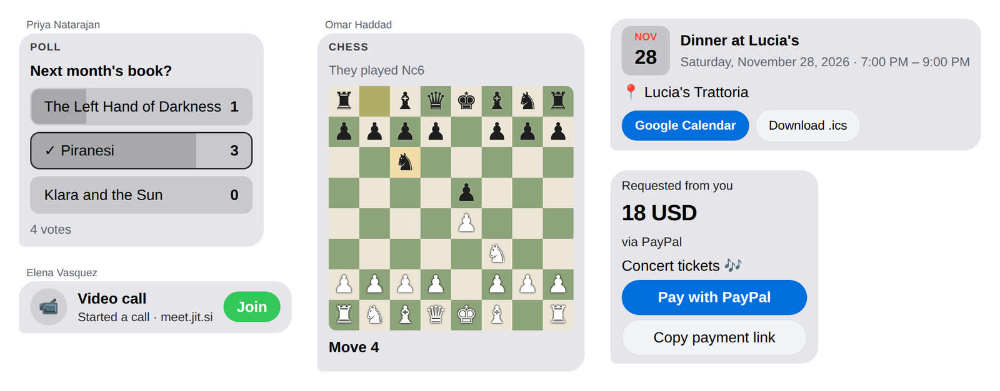

<div align="center">


# FluidMessages

**Texting that finally feels good on Android:<br>private, beautiful, and packed with features. On your phone and your computer.**

<a href="https://github.com/Lin8x/FluidMessages/releases/latest"></a> <a href="https://github.com/Lin8x/FluidMessages/releases"></a> <a href="LICENSE"></a> 

<br>

<a href="https://github.com/Lin8x/FluidMessages/releases/latest/download/FluidMessages.apk"></a> <a href="#-get-it"></a>

**🌐 [fluidmessages.danieljalali.com](https://fluidmessages.danieljalali.com)**

</div>

<br>

## 😩 Texting on Android is stuck in the past

<p align="center">
  
</p>

Regular text messages haven't kept up.

- **Hearts become sentences.** When an iPhone friend loves your message, you get *Loved "See you at 7"* instead of a heart.
- **The "better texting" depends on luck.** Newer texting features (called RCS) only work if your carrier, your phone, and your app all happen to support them.
- **The apps are dull.** Most texting apps look the same, and you can barely change anything.
- **You can't tell how private it is.** Nothing tells you who could read a message.
- **Your texts aren't safe from loss.** Lose or switch your phone, and they can be gone.
- **You're stuck on your phone.** There's no simple way to text from your computer.

iPhone users have had a smooth, private, fun way to message for years. **FluidMessages brings that to Android, and to your computer.**

<br>

---

<br>

## 💚 Texting, the way it should feel

<p align="center">
  
</p>

FluidMessages is a texting app for Android that you use instead of the one your phone came with. It uses your normal phone number and works with everyone you already text, on any phone. No carrier deals, no sign-up, no account with us. It just makes texting better:

| | |
|---|---|
| ❤️ **Fun is back** | Real reactions, message effects, polls, plans, games, and hidden messages. Friends on any phone can still read and reply. |
| 🔒 **Privacy you can see** | A small lock on every chat tells you exactly who could read it. Lock the app, lock a chat, or hide one away. |
| 🎨 **Made to be yours** | Eight color themes, your own bubble colors, wallpapers, sounds, and motion. No more gray. |
| 📦 **Never lose your texts** | Password-protected backups to your phone, your own server, or a cloud service you choose. |
| 💻 **Text from your computer** | Read and reply from a browser or a desktop app, in sync with your phone. |
| 📞 **Calls built in** | A Phone tab for your calls, right next to your messages. |

**It's free, it has no ads, and it doesn't watch what you do.**

<br>

---

<br>

## 💙💚 Blue bubbles and green bubbles

On an iPhone, messages to other iPhones are **blue** and messages to Android phones turn **green**. Green means a plain, old-style text, which is why hearts arrive as clumsy sentences and group chats feel broken.

FluidMessages fixes this on the Android side. Those sentences turn back into real hearts, and you get polls, plans, and games right in the chat. Your iPhone friends don't have to change a thing.

<p align="center">
  
</p>

<br>

---

<br>

## ✨ What you can do

<table>
<tr>
<td align="center" width="33%">❤️<br><b>React with a heart</b><br><sub>Touch and hold a message to send ❤️, 👍 or 😆, each with its own little animation.</sub></td>
<td align="center" width="33%">↩️<br><b>Reply to one message</b><br><sub>In a busy group, answer the exact message you mean so nobody gets confused.</sub></td>
<td align="center" width="33%">🎉<br><b>Message effects</b><br><sub>Send with confetti, hearts, fireworks, or a big slam.</sub></td>
</tr>
<tr>
<td align="center">📊<br><b>Polls and plans</b><br><sub>Ask "which day works?" and watch the votes come in. Plan an event and see who's coming.</sub></td>
<td align="center">🎮<br><b>Games in the chat</b><br><sub>Chess, tic-tac-toe, four in a row, and rock paper scissors.</sub></td>
<td align="center">🤫<br><b>Hidden messages</b><br><sub>Send a message that stays blurred until your friend taps it.</sub></td>
</tr>
<tr>
<td align="center">✏️<br><b>Edit and format</b><br><sub>Fix a typo after sending, or write <b>bold</b> and <i>italic</i>.</sub></td>
<td align="center">🖼️<br><b>Photo editor</b><br><sub>Crop, filters, drawing, text, stickers, and background removal.</sub></td>
<td align="center">🔕<br><b>Quiet a chat</b><br><sub>Mute someone for an hour, a day, or for good.</sub></td>
</tr>
</table>

<p align="center">
  
</p>

<br>

### 🎨 Make it look like you

Pick a theme, choose your own bubble colors, set a wallpaper, and pick your sounds. Try everything in a practice inbox before you switch.

<p align="center">
  
</p>

<br>

### 💻 On your computer, too

Connect your phone and your texts show up on your computer, in a browser or the desktop app, so you can type on a real keyboard. Changes on one show up on the other.

<p align="center">
  
</p>

<br>

### ➕ And the cherry on top: your other chats

FluidMessages can also bring in chats from free networks like Matrix, XMPP, Email, and IRC, and join big communities with many chat rooms. They sit in the same inbox as your texts, each with a small tag so you know where it came from. Completely optional.

<details>
<summary><b>📸 See real screenshots</b></summary>
<br>
<p align="center">
  
  <br><br>
  
  <br><br>
  
</p>
<sub>Android screens are illustrations. Computer screenshots are real captures. Everything uses made-up names.</sub>
</details>

[See everything it can do →](docs/features.md)

<br>

---

<br>

## 🔒 Privacy you can actually see

Most texting apps never tell you how private a message is. FluidMessages shows a small lock on every conversation.

<p align="center">
  
</p>

- **Texts can be encrypted** when you and your friend both use FluidMessages. The lock turns green.
- **Lock it your way.** Lock the whole app, or just one chat, with a code or your fingerprint.
- **A hidden folder** keeps private chats out of your inbox.
- **Disappearing messages** remove themselves after a while.
- **Backups are password-protected** by default, and you choose where they go.

**What FluidMessages never does:** show ads, track you, or ask you to make an account with us. Every line of code is public, so anyone can check.

<br>

---

<br>

## 📥 Get it

### 📱 On an Android phone

<p align="center">
  <a href="https://github.com/Lin8x/FluidMessages/releases/latest/download/FluidMessages.apk"></a>
</p>

<p align="center">
  
</p>

1. **Download** it with the button above, on your phone. It needs Android 13 or newer.
2. **Install** it: open the downloaded file, then tap **Install**. Your phone may ask you to allow installing apps from your browser. That's expected for apps that aren't from the Play Store.
3. **Set it up:** pick your colors, try the practice inbox if you like, then tap **Set as default SMS app** so FluidMessages sends your texts. Your existing texts stay right where they are.

> [!TIP]
> On Android 15, if setting it as your texting app is blocked, go to **Settings → Apps → FluidMessages → ⋮ → Allow restricted settings** and try again.

The app tells you when there's an update.

### 💻 On a computer

| Your computer | Download | Good to know |
|---|---|---|
| 🪟 **Windows** | [Windows app](https://github.com/Lin8x/FluidMessages/releases/latest/download/FluidMessages-Web-Windows.exe) | Windows may warn you the first time. [Here's why, and what to do.](docs/self-hosting.md#desktop-apps) |
| 🍎 **Mac** | [Mac app](https://github.com/Lin8x/FluidMessages/releases/latest/download/FluidMessages-Web-macOS.dmg) | macOS may warn you the first time. [Here's what to do.](docs/self-hosting.md#desktop-apps) |
| 🐧 **Linux** | [Linux app](https://github.com/Lin8x/FluidMessages/releases/latest/download/FluidMessages-Web-Linux-x86_64.AppImage) | Linux is a free alternative to Windows and macOS. If you're not sure, you don't use it. |

To see your texts there, connect your Android phone from **Settings → Phone and other devices**.

<br>

---

<br>

## ❓ Questions

<details>
<summary><b>Is it really free?</b></summary>
<br>
Yes. No price, no subscription, no ads. It's open source, so anyone can read exactly how it works.
</details>

<details>
<summary><b>Do my friends need FluidMessages too?</b></summary>
<br>
No. It works with everyone you already text, on any phone. If they also have FluidMessages, your texts to each other can be encrypted, and extras like hidden messages look their best.
</details>

<details>
<summary><b>Is this RCS?</b></summary>
<br>
No. RCS is a newer texting standard that only works when your carrier, phone, and app all support it, and on Android only a couple of big companies' apps are allowed to use it. FluidMessages gives you reactions, effects, polls, and more over regular texts instead, so they work with anyone.
</details>

<details>
<summary><b>Does it work on iPhone?</b></summary>
<br>
Not as a texting app. Apple only lets its own Messages app send texts. iPhone users can still use FluidMessages on a computer for the other chats.
</details>

<details>
<summary><b>Will I lose my old texts?</b></summary>
<br>
No. FluidMessages reads the texts already on your phone. If you ever go back to your old app, they're still there.
</details>

<details>
<summary><b>Is it safe to install from here instead of the Play Store?</b></summary>
<br>
It's built in the open, right here on GitHub, where anyone can check the code. Your phone asks before installing apps from outside the Play Store, which is normal.
</details>

<br>

---

<br>

## 📖 Words you might see

<details>
<summary><b>Tap to see plain-English explanations</b></summary>
<br>

| Word | What it means |
|---|---|
| **Encrypted** | Scrambled so only the right people can read it. Like a sealed letter instead of a postcard. |
| **SMS / MMS** | Regular text messages, and picture messages. What every phone can send. |
| **RCS** | A newer kind of texting from phone companies that only works when your carrier, phone, and app all support it. |
| **Reaction** | A quick emoji, like ❤️ or 👍, on a message instead of a whole reply. |
| **Backup** | A saved copy of your messages, so you can get them back on a new phone. |
| **APK** | The install file for an Android app, like the box an app comes in. |
| **Linux** | A free alternative to Windows and macOS. |
| **Matrix, XMPP, IRC** | Free chat networks that no single company owns, a bit like email but for chatting. |
| **Open source** | Anyone can see, check, and improve the code that makes the app work. |
| **Self-hosting** | Running the computer version on your own machine at home instead of a company's computers. Optional, for tech-savvy people. |

</details>

<br>

---

<br>

## 🛠️ For tech-savvy folks

<details>
<summary><b>🏠 Run the computer version yourself (self-hosting)</b></summary>
<br>

FluidMessages Web is the computer version, and you can run it on your own machine or home server. It works on its own for Matrix, XMPP, Email, and IRC, and your Android phone adds your texts. It runs anywhere Docker does, even a Raspberry Pi.

```sh
docker compose up -d
```

Open <http://localhost:8080>. On that computer it opens straight into a short welcome, with no password or code.

To use it from other devices or add your texts, open **Settings → Phone and other devices**. It walks you through setting a password and connecting your Android phone.

Also available: the [server download](https://github.com/Lin8x/FluidMessages/releases/latest/download/FluidMessages-Server.zip) and the Docker image `ghcr.io/lin8x/fluidmessages-web`.

[Full self-hosting guide →](docs/self-hosting.md) (HTTPS, Portainer, connecting your phone, and installing it as an app)

</details>

<details>
<summary><b>📚 Docs</b></summary>
<br>

| | |
|---|---|
| 📖 [Features](docs/features.md) | Everything the app can do. |
| 🏠 [Self-hosting](docs/self-hosting.md) | Docker, Portainer, HTTPS, and desktop apps. |
| 🛠️ [Development](docs/development.md) | Building, testing, and releasing. |
| 🤝 [Contributing](CONTRIBUTING.md) | How to help. |

Built with      

</details>

<details>
<summary><b>🤝 Contributing</b></summary>
<br>

Everyone is welcome, and you don't have to write code to help.

| | |
|---|---|
| 🐛 **Report a bug** | [Open an issue](https://github.com/Lin8x/FluidMessages/issues/new) with what you did and what happened. |
| 💡 **Suggest an idea** | [Open an issue](https://github.com/Lin8x/FluidMessages/issues/new) and tell us what you'd like. |
| 📱 **Test on your phone** | Try new releases and tell us what works on your phone and carrier. |
| 🧑‍💻 **Write code** | Fix a bug or build a feature, then open a pull request. |

**Code in four steps:**

1. Fork the repo and clone it.
2. Build the app: `./gradlew assembleDebug` (needs JDK 17 and Android SDK 35).
3. Run the checks: `./scripts/test-local`.
4. Open a pull request. For screen changes, add a screenshot.

Please use made-up names and messages in screenshots and tests. Read [CONTRIBUTING.md](CONTRIBUTING.md) for the full guide.

</details>

<br>

## 📄 License

FluidMessages is free and open source under the [Apache License 2.0](LICENSE).

<div align="center">
<br>
<br>
<sub>Made with 💚 for everyone stuck with green bubbles.</sub><br>
<sub><a href="https://fluidmessages.danieljalali.com">fluidmessages.danieljalali.com</a></sub>
</div>
