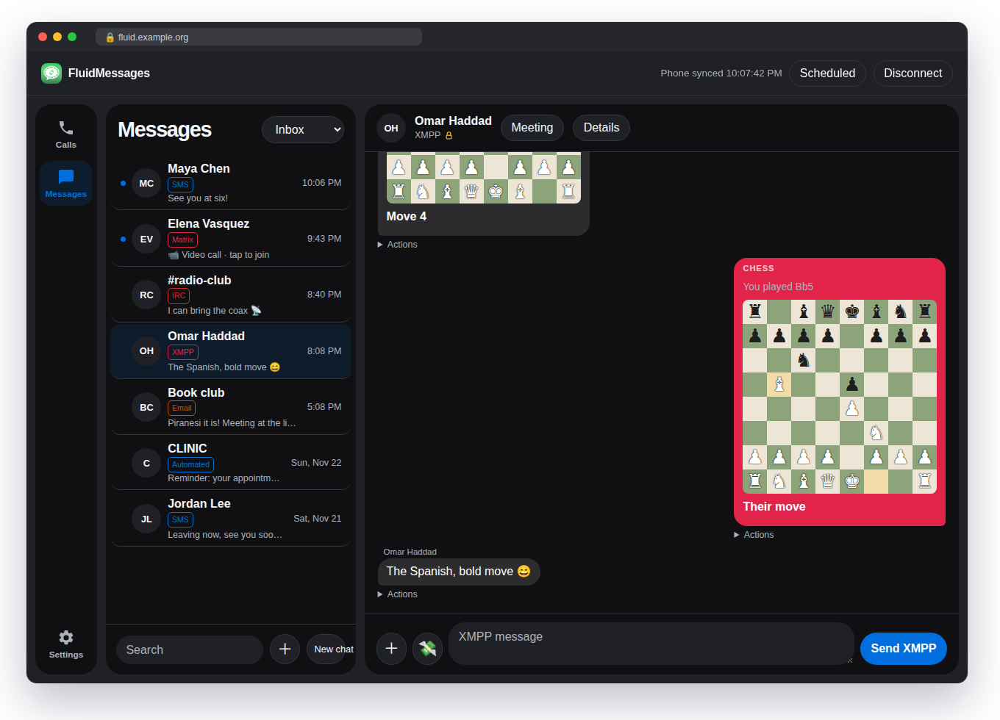

<div align="center">


# FluidMessages

**Take your messages back.**

A free messaging app with no ads, no tracking, and no big company in the middle.<br>Better texting on Android. Private chat on every device.

<a href="https://github.com/Lin8x/FluidMessages/releases/latest"></a> <a href="LICENSE"></a> 

<br>

<a href="https://github.com/Lin8x/FluidMessages/releases/latest/download/FluidMessages.apk"></a> <a href="#-on-a-computer"></a>

**🌐 [fluidmessages.danieljalali.com](https://fluidmessages.danieljalali.com)**

</div>

<br>

<p align="center">
  
</p>

**Jump to:** [The problem](#-who-can-read-your-texts) · [The fix](#-fluidmessages-opens-the-gate) · [For Android](#-on-android-the-texting-app-you-should-have-had) · [For iPhone and computers](#-on-iphone-or-a-computer-private-chat-nobody-owns) · [Get it](#-get-it)

<br>

# 👀 Who can read your texts?

<p align="center">
  
</p>

A regular text message is like a **postcard**. It is not sealed. Your phone company can read it, and so can anyone who breaks in along the way.

This is not a made-up fear:

- **In 2024, hackers broke into major U.S. phone companies.** They were able to see who was texting and calling whom, and in some cases the calls and texts themselves.
- **The FBI then told Americans to use encrypted messaging** instead of regular texts. ([NPR](https://www.npr.org/2024/12/17/nx-s1-5223490/text-messaging-security-fbi-chinese-hackers-security-encryption), [NBC News](https://www.nbcnews.com/tech/security/us-officials-urge-americans-use-encrypted-apps-cyberattack-rcna182694))
- Phone companies keep records of who you text and when. Police and governments can ask for those records.

**Encrypted** means your message is scrambled on your phone, so only the person you sent it to can read it. It is a **sealed letter** instead of a postcard.

Most texting apps never tell you which one you are sending.

<br>

# 🧱 Your phone came with walls

<p align="center">
  
</p>

When you bought your phone, you also got a messaging app picked by a giant company.

- **On an iPhone, it is Apple's.** Blue bubbles are nice, but they only work between Apple devices. Text someone outside the wall and the good parts go away.
- **On Android, it is Google's or Samsung's.** The app that came with your phone decides what you can do, how it looks, and where your messages are kept.

Either way, it is **their app, their rules, and their cloud**. You can't change it much. You can't easily take your messages with you. And you can't see what happens to them.

People call this a **walled garden**. It is pretty inside. But you are not allowed to leave with your stuff.

<br>

## The wall has a color: green

<p align="center">
  
</p>

On an iPhone, a text from an Android phone shows up **green**. Reactions turn into odd sentences. Group chats break. The Android person gets blamed, and friends say *"just get an iPhone."*

That is the wall doing its job. **Android phones can do better. The texting apps just never tried.**

<br>

---

<br>

# 🔓 FluidMessages opens the gate

<p align="center">
  
</p>

FluidMessages is a messaging app that **belongs to the people who use it**, not to a phone maker.

- **No ads. No tracking.** Nobody is selling your attention.
- **No account with us.** There is nothing to sign up for.
- **No company holding your messages.** They stay on your own devices.
- **Free, and the code is public.** Anyone can read it and check what it does.
- **Your choice, always.** Change how it looks. Back up your messages where you want. Leave any time, and your texts stay on your phone.

<br>

---

<br>

# 🤖 On Android: the texting app you should have had

<p align="center">
  
</p>

FluidMessages takes the place of the texting app your phone came with. You keep **your same phone number**. You text **the same people**. Your old texts are already there when you open it.

What gets better:

- ❤️ **Real reactions.** Sentences like *Loved "See you at 7"* turn back into hearts, even from iPhone friends.
- 📊 **Polls, plans, and games** right in the chat.
- 🎉 **Effects** like confetti and fireworks.
- 🔒 **A lock on every chat** that shows who could read it.
- 📦 **Backups** locked with your password.
- 💻 **Texting from your computer**, if you set up the link (see below).
- 🎨 **Your colors, your style.**

> [!NOTE]
> **What you give up, honestly.** FluidMessages does not do "RCS chats" yet (the newer kind of texting in Google Messages, with typing dots and sharper videos). Your texts go as regular texts and picture messages. If RCS chats is on in Google Messages, **turn it off there before you switch**, so no messages get stuck in the old app.

<br>

## Your friends don't need the app

<p align="center">
  
</p>

You can use every feature with **anyone**, on any phone. They do not have to install anything.

Say you send a poll. A friend without FluidMessages gets a **normal text message** with the question and simple directions, like *"Reply 1 for Pizza. Reply 2 for Tacos."* They text back **1**, and your poll counts their vote.

So nothing breaks for them. It just looks simple on their phone, and fancy on yours. If two people both have FluidMessages, they both get the fancy version. They can also **lock their texts to each other**: you both type in the same secret code once, and after that only your two phones can read those texts.

<br>

## Make it look like you

<p align="center">
  
</p>

Pick from 8 themes, each in light and dark. Then change the bubble colors, the wallpaper, the sounds, and how much things move. You can even give one chat its own look.

<details>
<summary><b>🖼️ See all eight themes</b></summary>
<br>
<p align="center"></p>
</details>

<br>

---

<br>

# 🍎 On iPhone or a computer: private chat nobody owns

No Android phone? FluidMessages still works for you, on **Windows, Mac, Linux, iPhone, and iPad**.

One honest note first: **an iPhone can't send regular texts through FluidMessages.** Apple does not let any other app do that. Only Android does. So on an iPhone or a computer, you use FluidMessages for the other ways to chat below.

<p align="center">
  
</p>

These are **open chat services**. No single company owns them, so no single company can lock you in.

- **Matrix:** modern group chat. Used by communities, schools, and workplaces.
- **XMPP:** simple, private chat. It works like email: pick any provider and talk to people on all the others.
- **Email:** your normal email, shown as chats.
- **IRC:** big public chat rooms for hobbies and projects.

You also get voice and video calls, meeting links for Zoom, Google Meet, Teams, and Jitsi, communities with many rooms, and the same themes, reactions, polls, and games. FluidMessages walks you through setting up each one, step by step.

**How it works on each device**

| Your device | How you use FluidMessages | Texting with your phone number |
|---|---|:---:|
| 🤖 Android phone | Install the app | ✅ |
| 🪟 Windows, 🍎 Mac, 🐧 Linux | Install the computer app | ✅ if you link an Android phone (takes some setup) |
| 📱 iPhone, iPad | Open it in your browser from a computer that runs FluidMessages, then add it to your home screen | ✅ if you link an Android phone (takes some setup) |

<br>

---

<br>

# 🔒 Privacy you can see

<p align="center">
  
</p>

Every chat shows a small lock, so you never have to guess.

<p align="center">
  
</p>

- **App lock:** opens only with your fingerprint or code.
- **Hidden folder:** private chats vanish from your inbox until you unlock them.
- **Decoy code:** a second code opens a harmless pretend inbox, for when someone makes you unlock your phone.
- **Emergency erase:** a special code quietly wipes everything.
- **Disappearing messages:** messages delete themselves after an hour, a day, or a week.

<br>

# 📦 Never lose a text again

<p align="center">
  
</p>

Phones break. Phones get lost. With most texting apps, your messages go with them.

FluidMessages saves your texts, photos, and settings in a **backup locked with your password**. You pick where it goes: your phone, your own computer, or a cloud like Google Drive. Set it once and it backs up on its own. Get a new phone, and everything comes back.

<br>

# 💻 Text from your computer

<p align="center">
  
</p>

Typing on a phone is slow. Link your Android phone to FluidMessages on your computer, and your texts show up there too. Read a message on one, and it is marked read on both.

> [!NOTE]
> **Linking takes some setup today.** It is not one tap yet. FluidMessages has to run on a computer at home with a secure web address, and the app's guide walks you through it. If that sounds like too much, the phone app works great on its own.

<br>

# 🎉 And a lot more

- ↩️ **Reply to one message** in a busy group.
- ✏️ **Fix a typo** after you send.
- 🤫 **Hidden messages** that stay blurry until your friend taps.
- 🖼️ **Photo editor** with crop, filters, drawing, and stickers.
- 🎙️ **Voice messages.**
- 🔕 **Mute a chat** for an hour, a day, or for good.
- 🚫 **Spam and unknown senders** kept out of your way.

<details>
<summary><b>📸 See real screenshots</b></summary>
<br>
<p align="center">
  
  <br><br>
  
  <br><br>
  
</p>
<sub>Android screens are illustrations. Computer screenshots are real captures. Everything uses made-up names.</sub>
</details>

[See everything it can do →](docs/features.md)

<br>

---

<br>

# 🚀 Get it

## 📱 On an Android phone

<p align="center">
  <a href="https://github.com/Lin8x/FluidMessages/releases/latest/download/FluidMessages.apk"></a>
</p>

<p align="center">
  
</p>

1. **Download** it with the green button, on your phone. It needs Android 13 or newer.
2. **Install** it. Open the file and tap **Install**. Your phone may ask if it is okay to install an app from your browser. That is normal for apps that are not in the Play Store.
3. **Make it your texting app.** The app walks you through it and asks for the few permissions it needs. Your old texts are already there.

You can switch back to your old app any time. Nothing is lost.

> [!TIP]
> On Android 15, if your phone blocks the last step, go to **Settings → Apps → FluidMessages → ⋮ → Allow restricted settings** and try again.

**Moving from an iPhone to Android?** Turn off iMessage on the iPhone first (**Settings → Apps → Messages**). If you don't, texts from iPhone friends can get lost.

## 💻 On a computer

| Your computer | Download | Good to know |
|---|---|---|
| 🪟 **Windows** | [Windows app](https://github.com/Lin8x/FluidMessages/releases/latest/download/FluidMessages-Web-Windows.exe) | Windows may warn you the first time. [Here's why, and what to do.](docs/self-hosting.md#desktop-apps) |
| 🍎 **Mac** | [Mac app](https://github.com/Lin8x/FluidMessages/releases/latest/download/FluidMessages-Web-macOS.dmg) | Your Mac may warn you the first time. [Here's what to do.](docs/self-hosting.md#desktop-apps) |
| 🐧 **Linux** | [Linux app](https://github.com/Lin8x/FluidMessages/releases/latest/download/FluidMessages-Web-Linux-x86_64.AppImage) | If you're not sure what Linux is, you don't have it. |

Open it and follow the welcome steps. To see your texts, link your Android phone in **Settings → Phone and other devices**.

## 🍎 On an iPhone or iPad

Run FluidMessages on a computer at home (see *Run it yourself* below). Then open its address in Safari on your iPhone and tap **Share → Add to Home Screen**. It opens like any other app. You get alerts while it is open; it can't wake your iPhone when it is closed yet.

<br>

---

<br>

# 💬 A note from the person who made this

I'm one person, not a company.

I made FluidMessages because I was tired of it. Tired of being the green bubble. Tired of a phone maker deciding how I talk to my friends. I looked for an app that fixed texting, kept my messages private, and worked on all my devices. I could not find one. So I built it.

**I used AI tools to help write the code**, and I want to be upfront about that. Here is why I think you can still trust it: every line is public. You don't have to take my word for anything. Anyone can read the code, test it, and tell me what is wrong, and I will fix it.

There are no ads here and nothing to buy. I just think your messages should belong to you. ([Privacy policy](docs/privacy.md))

<br>

---

<br>

## 🛠️ For tech-savvy folks

<details>
<summary><b>🏠 Run it yourself (self-hosting)</b></summary>
<br>

Run FluidMessages Web on your own machine or home server and open it from any device's browser. It works on its own for Matrix, XMPP, Email, and IRC, and a linked Android phone adds your texts. It runs anywhere Docker does, even a Raspberry Pi.

```sh
docker compose up -d
```

Open <http://localhost:8080>. On that computer it opens straight into a short welcome, with no password or code.

To use it from other devices or link your phone, open **Settings → Phone and other devices**. It walks you through setting a password and connecting your Android phone. Other devices need it served over HTTPS; the guide covers that.

Also available: the [server download](https://github.com/Lin8x/FluidMessages/releases/latest/download/FluidMessages-Server.zip) and the Docker image `ghcr.io/lin8x/fluidmessages-web`.

[Full self-hosting guide →](docs/self-hosting.md) (HTTPS, Portainer, linking your phone, and installing it as an app)

</details>

<details>
<summary><b>📚 Docs</b></summary>
<br>

| | |
|---|---|
| 📖 [Features](docs/features.md) | Everything the app can do. |
| 🏠 [Self-hosting](docs/self-hosting.md) | Docker, Portainer, HTTPS, and desktop apps. |
| 🛠️ [Development](docs/development.md) | Building, testing, and releasing. |
| 🤝 [Contributing](CONTRIBUTING.md) | How to help. |
| 🛡️ [Privacy policy](docs/privacy.md) | What the app sends, and where. |
| 🔐 [Security](SECURITY.md) | Report a problem privately. |

Built with      

</details>

<details>
<summary><b>🤝 Contributing</b></summary>
<br>

Everyone is welcome, and you don't have to write code to help.

| | |
|---|---|
| 🐛 **Report a bug** | [Open an issue](https://github.com/Lin8x/FluidMessages/issues/new) with what you did and what happened. |
| 💡 **Suggest an idea** | [Open an issue](https://github.com/Lin8x/FluidMessages/issues/new) and tell us what you'd like. |
| 📱 **Test on your phone** | Try new releases and tell us what works on your phone and carrier. |
| 🧑‍💻 **Write code** | Fix a bug or build a feature, then open a pull request. |

**Code in four steps:**

1. Fork the repo and clone it.
2. Build the app: `./gradlew assembleDebug` (needs JDK 17 and Android SDK 35).
3. Run the checks: `./scripts/test-local`.
4. Open a pull request. For screen changes, add a screenshot.

Please use made-up names and messages in screenshots and tests. Read [CONTRIBUTING.md](CONTRIBUTING.md) for the full guide.

</details>

<br>

## 📄 License

FluidMessages is free and open source under the [Apache License 2.0](LICENSE).

<div align="center">
<br>
<br>
<sub>Made with 💚 for everyone tired of the walls.</sub><br>
<sub><a href="https://fluidmessages.danieljalali.com">fluidmessages.danieljalali.com</a></sub>
</div>
