<div align="center">


# FluidMessages

**Better texting for Android. Private messaging for every device.**

The texting app Android always deserved: real reactions, privacy you can see, backups, and your own style.<br>Plus open chat services you can use on any computer, with or without an Android phone.

<a href="https://github.com/Lin8x/FluidMessages/releases/latest"></a> <a href="https://github.com/Lin8x/FluidMessages/releases"></a> <a href="LICENSE"></a> 

<br>

<a href="https://github.com/Lin8x/FluidMessages/releases/latest/download/FluidMessages.apk"></a> <a href="#-on-any-computer"></a>

**🌐 [fluidmessages.danieljalali.com](https://fluidmessages.danieljalali.com)**

<br>

| 🍎 **Coming from an iPhone?** | 🤖 **Already on Android?** | 💻 **No Android phone?** |
|:---:|:---:|:---:|
| [See what you keep, and what gets better →](#-the-problem-with-texting-today) | [See why your texting app falls short →](#-the-problem-with-texting-today) | [Use it on any computer →](#-phone-and-computer-in-sync) |

</div>

<br>

# 😩 The problem with texting today

## Texting on Android is stuck in the past

<p align="center">
  
</p>

Regular texting (SMS) is decades old, and most Android texting apps barely improve on it. Reactions arrive as sentences, the apps are plain, and backups and computer access are usually missing. The newer standard, RCS, only works if your carrier, your phone, and your app all happen to support it.

<br>

## "Ew, green bubble"

<p align="center">
  
</p>

On an iPhone, messages between iPhones are **blue**. Messages to an Android phone turn **green**: plain, old-style texts. Reactions show up as sentences like *Laughed at "I'm in! 🔥"*, polls and effects don't work, and the Android person gets the blame. So groups give up and move everyone to WhatsApp, Discord, or "just get an iPhone."

**None of that is necessary.** Android can do all of it; the texting apps just never did.

<br>

## Your texts are less private than you think

<p align="center">
  
</p>

A regular text is like a **postcard**: your phone company, and anyone who gets hold of it on the way, can read it. **Encrypted** means a message is scrambled on your phone so only the person you sent it to can unscramble it, like a **sealed letter**.

Most texting apps never tell you which one you're sending. You also can't lock them, hide a conversation, or protect your messages if someone grabs your unlocked phone.

<br>

---

<br>

# 💚 FluidMessages fixes texting

<p align="center">
  
</p>

FluidMessages replaces the texting app your Android phone came with. It uses your normal phone number and works with everyone you already text, on any phone. **No carrier deals, no sign-up, no account with us. Free, with no ads.**

| | |
|---|---|
| ❤️ **Fun is back** | Real reactions, effects, polls, plans, and games. *Loved "…"* sentences turn back into hearts. |
| 🔒 **Privacy you can see** | A lock on every chat shows who could read it. Texts between FluidMessages users can be encrypted. |
| 🎨 **Made to be yours** | Themes, bubble colors, wallpapers, sounds, and motion. |
| 📦 **Never lose a text** | Password-locked backups, saved wherever you choose. |
| 💻 **Text from your computer** | Link your phone and reply from any computer, in sync. |
| 🌐 **More than texts** | Add open chat services like Matrix and XMPP to the same inbox. |

<br>

## Friends without the app still get it

<p align="center">
  
</p>

Everything you send still works for people without FluidMessages, on any phone. It just looks plainer on their end: polls, games, and plans arrive as text with simple instructions like *Reply with a number to vote*, and **their reply still counts**.

> [!NOTE]
> **It's not perfect for them, but it works.** For once, the other side gets the plain version. Anyone on Android can get the full experience by installing FluidMessages, and two FluidMessages users get everything, including encrypted texts.

<br>

---

<br>

# 🎨 Make it yours

<p align="center">
  
</p>

Pick one of eight themes, each in light and dark, then make it your own: bubble colors and shapes, wallpapers, send and receive sounds, and how much things move. Give a single chat its own look if you like. You can try every theme in a practice inbox before you switch.

<details>
<summary><b>🖼️ See all eight themes</b></summary>
<br>
<p align="center"></p>
</details>

<br>

---

<br>

# 🔒 Privacy you can see and control

## A lock on every chat

<p align="center">
  
</p>

Every conversation shows a small lock, so you always know who could read it. Texts between two FluidMessages users can be encrypted, and then the lock turns green.

<br>

## Tools for real-life privacy

<p align="center">
  
</p>

- **App lock:** open FluidMessages with your fingerprint or code, or lock a single chat.
- **Hidden folder:** private chats disappear from your inbox until you unlock them.
- **Decoy mode:** a second code opens a harmless pretend inbox, for when someone forces you to unlock your phone.
- **Emergency erase:** a special code quietly wipes everything and looks like a normal unlock.
- **Disappearing messages:** messages remove themselves after an hour, a day, or a week.

**What FluidMessages never does:** show ads, track you, or ask you to make an account with us. Every line of code is public, so anyone can check.

<br>

---

<br>

# 📦 Never lose a text again

<p align="center">
  
</p>

Phones get lost, broken, and replaced. With most texting apps, your conversations go with them. FluidMessages packs your texts, photos, group chats, and settings into a **backup locked with your password**, then saves it where you choose: on your phone, on your own computer or home server, or in a cloud service like Google Drive or OneDrive. Set a schedule and it happens on its own. On your next phone, restore it and everything is back.

<br>

---

<br>

# 🔗 Phone and computer, in sync

<p align="center">
  
</p>

Typing long messages on a phone is slow, and you shouldn't have to pick up your phone at your desk. Link your Android phone to FluidMessages on your computer and your texts show up there. Read on one and it's read on both, and your settings stay in sync. If you changed the same thing in both places, it asks which one to keep.

<br>

## No Android phone? You're covered too

FluidMessages also runs **on its own on any computer**: Windows, Mac, Linux, or in a web browser, including on an iPhone or iPad. Without an Android phone you can't send texts, but you get the open chat services below, communities, voice and video calls, and the same themes, reactions, polls, and games.

<p align="center">
  
</p>

| | 📱 Android phone | 💻 Any computer, no phone | 🔗 Both, linked |
|---|:---:|:---:|:---:|
| Your texts and picture texts | ✅ | ➖ | ✅ on both |
| Calls from your phone number | ✅ | ➖ | ✅ start them from your computer |
| Open chat services and communities | ✅ | ✅ | ✅ |
| Voice and video calls on chat services | ✅ | ✅ | ✅ |
| Reactions, effects, polls, games, themes | ✅ | ✅ | ✅ |
| Works on Windows, Mac, Linux, iPhone, iPad | ➖ | ✅ | ✅ |
| Settings and reading kept in sync | ➖ | ➖ | ✅ |

<br>

---

<br>

# 🌐 More than texts

<p align="center">
  
</p>

Texts are tied to phone numbers and phone companies. **Open chat services** are free networks that no single company owns, and FluidMessages puts them in the same inbox as your texts, each with a small tag so you know where a chat lives.

- **Matrix:** modern group chats, rooms, and communities, used by workplaces and projects.
- **XMPP:** a long-running chat standard, run by many independent servers.
- **Email:** chat with anyone who has an email address. Only the conversations you choose show up.
- **IRC:** big public chat rooms about hobbies and open-source projects.

Join **communities** with many rooms, browse public servers, and use as many accounts as you like. All of this is optional; FluidMessages is a complete texting app without it.

<br>

---

<br>

# 🎉 Everything else you can do

<table>
<tr>
<td align="center" width="33%">❤️<br><b>React with a heart</b><br><sub>Touch and hold a message to send ❤️, 👍 or 😆, each with its own animation.</sub></td>
<td align="center" width="33%">↩️<br><b>Reply to one message</b><br><sub>In a busy group, answer the exact message you mean.</sub></td>
<td align="center" width="33%">🎉<br><b>Message effects</b><br><sub>Send with confetti, hearts, fireworks, or a big slam.</sub></td>
</tr>
<tr>
<td align="center">📊<br><b>Polls and plans</b><br><sub>Ask "which day works?" and watch the votes come in. Plan an event and see who's coming.</sub></td>
<td align="center">🎮<br><b>Games in the chat</b><br><sub>Chess, tic-tac-toe, four in a row, and rock paper scissors.</sub></td>
<td align="center">🤫<br><b>Hidden messages</b><br><sub>A message that stays blurred until your friend taps it.</sub></td>
</tr>
<tr>
<td align="center">✏️<br><b>Edit and format</b><br><sub>Fix a typo after sending, or write <b>bold</b> and <i>italic</i>.</sub></td>
<td align="center">🖼️<br><b>Photo editor</b><br><sub>Crop, filters, drawing, text, stickers, and background removal.</sub></td>
<td align="center">🔕<br><b>Quiet a chat</b><br><sub>Mute someone for an hour, a day, or for good.</sub></td>
</tr>
</table>

<p align="center">
  
</p>

<details>
<summary><b>📸 See real screenshots</b></summary>
<br>
<p align="center">
  
  <br><br>
  
  <br><br>
  
</p>
<sub>Android screens are illustrations. Computer screenshots are real captures. Everything uses made-up names.</sub>
</details>

[See everything it can do →](docs/features.md)

<br>

---

<br>

# 🚀 Get it

## 🍎 Switching from an iPhone

1. **Turn off iMessage before you switch.** On your iPhone, go to **Settings → Apps → Messages** and turn off iMessage. If your iPhone is already gone, use Apple's *Deregister iMessage* page. Otherwise, texts from iPhone friends can keep going to iMessage instead of your new phone.
2. **Install FluidMessages** on your Android phone (below) and make it your texting app.
3. **Text your iPhone friends like always.** Their hearts and reactions show up properly, and they don't need to change anything.

## 🤖 Already on Android

Install FluidMessages and make it your texting app. Your existing texts stay right where they are, so you can switch back any time without losing anything.

## 📱 On an Android phone

<p align="center">
  <a href="https://github.com/Lin8x/FluidMessages/releases/latest/download/FluidMessages.apk"></a>
</p>

<p align="center">
  
</p>

1. **Download** it with the button above, on your phone. It needs Android 13 or newer.
2. **Install** it: open the downloaded file, then tap **Install**. Your phone may ask you to allow installing apps from your browser; that's normal for apps that aren't from the Play Store. The code is all public here on GitHub.
3. **Set it up:** pick your colors, try the practice inbox if you like, then tap **Set as default SMS app**.

> [!TIP]
> On Android 15, if setting it as your texting app is blocked, go to **Settings → Apps → FluidMessages → ⋮ → Allow restricted settings** and try again.

The app tells you when there's an update.

## 💻 On any computer

| Your computer | Download | Good to know |
|---|---|---|
| 🪟 **Windows** | [Windows app](https://github.com/Lin8x/FluidMessages/releases/latest/download/FluidMessages-Web-Windows.exe) | Windows may warn you the first time. [Here's why, and what to do.](docs/self-hosting.md#desktop-apps) |
| 🍎 **Mac** | [Mac app](https://github.com/Lin8x/FluidMessages/releases/latest/download/FluidMessages-Web-macOS.dmg) | macOS may warn you the first time. [Here's what to do.](docs/self-hosting.md#desktop-apps) |
| 🐧 **Linux** | [Linux app](https://github.com/Lin8x/FluidMessages/releases/latest/download/FluidMessages-Web-Linux-x86_64.AppImage) | A free alternative to Windows and macOS. If you're not sure, you don't use it. |

Add your chat accounts in **Settings → Accounts**, and link your Android phone for texts in **Settings → Phone and other devices**.

**On an iPhone, iPad, or another computer's browser:** run FluidMessages on a computer or home server (see *Run it yourself* below), then open its address in your browser and add it to your home screen.

<br>

---

<br>

## 🛠️ For tech-savvy folks

<details>
<summary><b>🏠 Run it yourself (self-hosting)</b></summary>
<br>

Run FluidMessages Web on your own machine or home server and open it from any device's browser. It works on its own for Matrix, XMPP, Email, and IRC, and a linked Android phone adds your texts. It runs anywhere Docker does, even a Raspberry Pi.

```sh
docker compose up -d
```

Open <http://localhost:8080>. On that computer it opens straight into a short welcome, with no password or code.

To use it from other devices or link your phone, open **Settings → Phone and other devices**. It walks you through setting a password and connecting your Android phone. Other devices need it served over HTTPS; the guide covers that.

Also available: the [server download](https://github.com/Lin8x/FluidMessages/releases/latest/download/FluidMessages-Server.zip) and the Docker image `ghcr.io/lin8x/fluidmessages-web`.

[Full self-hosting guide →](docs/self-hosting.md) (HTTPS, Portainer, linking your phone, and installing it as an app)

</details>

<details>
<summary><b>📚 Docs</b></summary>
<br>

| | |
|---|---|
| 📖 [Features](docs/features.md) | Everything the app can do. |
| 🏠 [Self-hosting](docs/self-hosting.md) | Docker, Portainer, HTTPS, and desktop apps. |
| 🛠️ [Development](docs/development.md) | Building, testing, and releasing. |
| 🤝 [Contributing](CONTRIBUTING.md) | How to help. |

Built with      

</details>

<details>
<summary><b>🤝 Contributing</b></summary>
<br>

Everyone is welcome, and you don't have to write code to help.

| | |
|---|---|
| 🐛 **Report a bug** | [Open an issue](https://github.com/Lin8x/FluidMessages/issues/new) with what you did and what happened. |
| 💡 **Suggest an idea** | [Open an issue](https://github.com/Lin8x/FluidMessages/issues/new) and tell us what you'd like. |
| 📱 **Test on your phone** | Try new releases and tell us what works on your phone and carrier. |
| 🧑‍💻 **Write code** | Fix a bug or build a feature, then open a pull request. |

**Code in four steps:**

1. Fork the repo and clone it.
2. Build the app: `./gradlew assembleDebug` (needs JDK 17 and Android SDK 35).
3. Run the checks: `./scripts/test-local`.
4. Open a pull request. For screen changes, add a screenshot.

Please use made-up names and messages in screenshots and tests. Read [CONTRIBUTING.md](CONTRIBUTING.md) for the full guide.

</details>

<br>

## 📄 License

FluidMessages is free and open source under the [Apache License 2.0](LICENSE).

<div align="center">
<br>
<br>
<sub>Made with 💚 for everyone tired of being the green bubble.</sub><br>
<sub><a href="https://fluidmessages.danieljalali.com">fluidmessages.danieljalali.com</a></sub>
</div>
