<div align="center">


# FluidMessages

**Take your messages back.**

A free messaging app with no ads, no tracking, and no big company in the middle.<br>Better texting on Android. Private chat on every device.

<a href="https://github.com/Lin8x/FluidMessages/releases/latest"></a> <a href="LICENSE"></a> 

<br>

<a href="#android"></a> <a href="#get-it"></a>

</div>

<br>

<p align="center">
  
</p>

**Jump to:** [What it is](#what-is-fluidmessages) · [The problem](#who-can-read-your-texts) · [For Android](#on-android-the-texting-app-you-should-have-had) · [No Android phone?](#no-android-phone-message-people-another-way) · [No internet?](#no-internet-use-nearby) · [Get it](#get-it)

<br>

# What is FluidMessages?

Think of it as **texting, upgraded, for more than just texts.**

- **On an Android phone, it is your texting app.** Same number, same people, same old texts.
- **It also reaches people on open chat services**, like Matrix, XMPP, Email, and IRC, in the same inbox.
- **It adds the features that are missing.** Replies, reactions, forwarding, and polls work in texts and on every service it supports. Even email gets chat-style replies and reactions.
- **It always shows how each message is sent, and if it is locked** (private).

<p align="center">
  
</p>

**What it works with, and what it can't.** FluidMessages works with **open** services, which anyone's app is allowed to use: texting (SMS) from an Android phone, Matrix, XMPP, Email, and IRC. It **can't** connect to **closed** apps like WhatsApp or iMessage. The companies that own those apps don't let other apps in.

## Why not just use WhatsApp?

<p align="center">
  
</p>

A closed app like WhatsApp is an island. **WhatsApp users can only message other WhatsApp users**, and one company makes all the rules.

Open services work like email. You can send an email from Gmail to someone on Outlook, and it just works. Matrix, XMPP, and IRC are the same:

- **Anyone can run a server or pick a provider.** There is no single company in charge.
- **Nobody can lock you in.** Switch apps or providers and keep talking to the same people.
- **Your friends don't need FluidMessages.** They can answer from any app or device that speaks the same service. From an Android phone, you can text them too.

<br>

# Who can read your texts?

<p align="center">
  
</p>

A text message (SMS) is like a **postcard**. It is not sealed. Your phone company can read it, and so can anyone who breaks in along the way.

This is not a made-up fear:

- **In 2024, hackers broke into major U.S. phone companies.** They were able to see who was texting and calling whom, and in some cases the calls and texts themselves.
- **The FBI then told Americans to use encrypted messaging** instead of plain texts. ([NPR](https://www.npr.org/2024/12/17/nx-s1-5223490/text-messaging-security-fbi-chinese-hackers-security-encryption), [NBC News](https://www.nbcnews.com/tech/security/us-officials-urge-americans-use-encrypted-apps-cyberattack-rcna182694))
- Phone companies keep records of who you text and when. Police and governments can ask for those records.

**Encrypted**, or **locked**, means your message is scrambled on your phone, so only the person you sent it to can read it. It is a **sealed letter** instead of a postcard.

## Which way is your message going?

Every message you send travels one of a few ways:

- **As a text (SMS)**, through your phone carrier. Plain texts are not locked.
- **Through an internet chat service**, like Matrix or Email. Some of these are locked, and some are not.

Most texting apps never tell you which way a message went, or if it was locked. FluidMessages always shows you.

<p align="center">
  
</p>

In the real app, every chat in the inbox has a tag for how it is sent (SMS, Matrix, IRC, and so on), and the open chat shows its lock under the name:

<p align="center">
  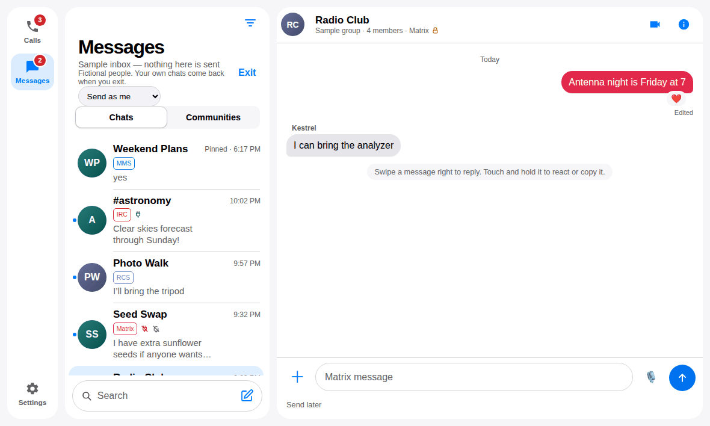
  <br><sub>FluidMessages on a computer. Real capture with made-up names.</sub>
</p>

<br>

# Your phone came with walls

<p align="center">
  
</p>

When you bought your phone, you also got a messaging app picked by a giant company.

- **On an iPhone, it is Apple's.** Blue bubbles are nice, but they only work between Apple devices. Text someone outside the wall and the good parts go away.
- **On Android, it is Google's or Samsung's.** The app that came with your phone decides what you can do, how it looks, and where your messages are kept.

Either way, it is **their app, their rules, and their cloud**. You can't change it much. You can't easily take your messages with you. And you can't see what happens to them.

People call this a **walled garden**. It is pretty inside, but you can't leave with your stuff.

The walls are also why iPhones and Android phones don't match. Each company keeps its best features inside, so they break when a message crosses over. That is a big reason so many Americans stick with iPhones, even though Android users make up a huge share of the people who text.

<br>

## Switching phones can lose your texts

<p align="center">
  
</p>

Your texts live inside that company's app. When you get a new phone, they may not come along. This happens going from iPhone to Android, and even from one Android phone to another.

FluidMessages keeps a **locked backup** of your texts. On your new Android phone, install FluidMessages, restore the backup, and your texts are back. [How backups work ↓](#never-lose-a-text-again)

> [!TIP]
> **Coming from an iPhone?** FluidMessages can't pull old texts out of Apple's app. Turn off iMessage before you switch, so new texts reach your new phone.

<br>

## Blue bubbles and green bubbles

<p align="center">
  
</p>

The colors are not just for looks. They tell you **how the message traveled**:

- **Blue** means Apple's own service, iMessage, carried it. That only works iPhone to iPhone.
- **Green** means it fell back to plain texting (SMS), usually because someone in the chat has Android.

When a chat falls back to green, reactions turn into odd sentences and group chats break. The Android person gets blamed, and friends say *"just get an iPhone."*

That is the wall doing its job. **Android phones can do better. The texting apps just never tried.**

## What your iPhone friends see

<p align="center">
  
</p>

Say you put a ❤️ on a friend's text. Over plain texting, FluidMessages sends it the way every texting app does: as words, like *Loved "Movie at 8?"*

Whether your iPhone friend sees a heart or those words is **up to Apple's Messages app**, not FluidMessages. FluidMessages can only make things work on its own side. Apple's rules also keep it from being a texting app on iPhones. If I could make one, I would.

On your side, it works both ways. When an iPhone friend's *Liked "…"* text arrives, FluidMessages turns it back into a reaction on the right message:

<p align="center">
  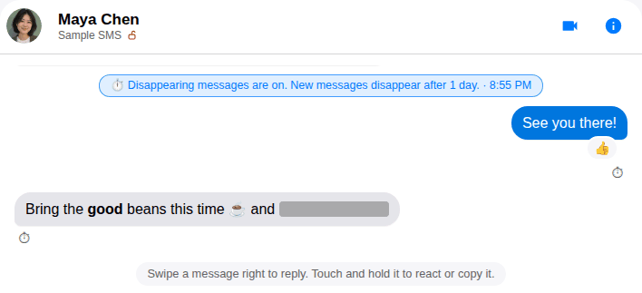
  <br><sub>A sample text chat. Real capture with made-up names.</sub>
</p>

<br>

---

<br>

# FluidMessages opens the gate

<p align="center">
  
</p>

FluidMessages is a messaging app that **belongs to the people who use it**, not to a phone maker.

- **No ads. No tracking.** Nobody is selling your attention.
- **No account with us.** There is nothing to sign up for.
- **No company holding your messages.** They stay on your own devices.
- **Free, and the code is public.** Anyone can read it and check what it does.
- **Your choice, always.** Change how it looks. Back up your messages where you want. Leave any time, and your texts stay on your phone.

<br>

---

<br>

# On Android: the texting app you should have had

<p align="center">
  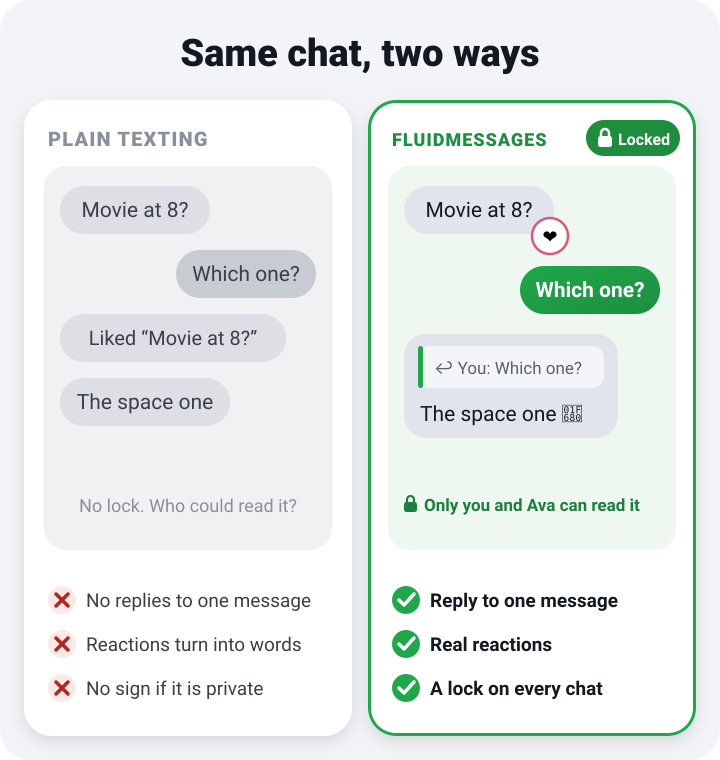
</p>
<p align="center"><sub>The lock is green here because Ava uses FluidMessages too. With a friend on plain texting, it shows red.</sub></p>

FluidMessages takes the place of the texting app your phone came with. You keep **your same phone number**. You text **the same people**. Your old texts are already there when you open it.

What gets better:

- ❤️ **Real reactions.** Sentences like *Loved "See you at 7"* turn back into hearts, even from iPhone friends.
- 📊 **Polls, plans, and games** right in the chat.
- 🎉 **Effects** like confetti and fireworks.
- ↩️ **Replies and forwarding** for one message at a time.
- 🔒 **A lock on every chat** that shows if it is private.
- 📦 **Backups** locked with your password.
- 💻 **Texting from your computer**, if you set up the link (see below).
- 🎨 **Your colors, your style.**

> [!NOTE]
> **What you give up, honestly.** FluidMessages does not do "RCS chats" yet (the newer kind of texting in Google Messages, with typing dots and sharper videos). Your texts go as plain texts (SMS) and picture messages (MMS). If RCS chats is on in Google Messages, **turn it off there before you switch**, so no messages get stuck in the old app.

<br>

## Your friends don't need the app

<p align="center">
  
</p>

You can use every feature with **anyone**, on any phone. They do not have to install anything.

Say you send a poll. A friend without FluidMessages gets a **normal text message** with the question and simple directions, like *"Reply 1 for Pizza. Reply 2 for Tacos."* They text back **1**, and your poll counts their vote.

So nothing breaks for them. It just looks simple on their phone, and fancy on yours. If two people both have FluidMessages, they both get the fancy version. They can also **lock their texts to each other**: you both type in the same secret code once, and after that only your two phones can read those texts.

<br>

## Make it look like you

<p align="center">
  
</p>

Pick from 8 themes, each in light and dark. Then change the bubble colors, the wallpaper, the sounds, and how much things move. You can even give one chat its own look.

<details>
<summary><b>🖼️ See all eight themes</b></summary>
<br>
<p align="center">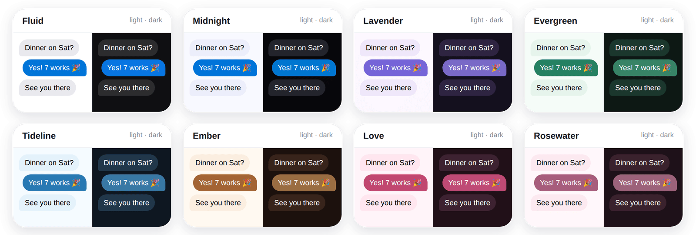</p>
</details>

<br>

---

<br>

# No Android phone? Message people another way

**Texting (SMS) in FluidMessages needs an Android phone.** Apple does not let any other app send texts on an iPhone, so there is no FluidMessages iPhone app. On a computer, texting only works while it can reach your linked Android phone.

When texting can't work, you can still message people through **open chat services**. These work in FluidMessages on **Windows, Mac, Linux, iPhone, and iPad**, with or without an Android phone.

<p align="center">
  
</p>

No single company owns these services, so no single company can lock you in. Your friends can use FluidMessages or any other app that speaks the same service.

- **Matrix:** modern group chat. Used by communities, schools, and workplaces.
- **XMPP:** simple, private chat. It works like email: pick any provider and talk to people on all the others.
- **Email:** your normal email, shown as chats.
- **IRC:** big public chat rooms for hobbies and projects.

You also get voice and video calls, meeting links for Zoom, Google Meet, Teams, and Jitsi, communities with many rooms, and the same themes, reactions, polls, and games. FluidMessages walks you through setting up each one, step by step.

**How it works on each device**

<table><tr>
<td width="62%"></td>
<td width="38%" align="center">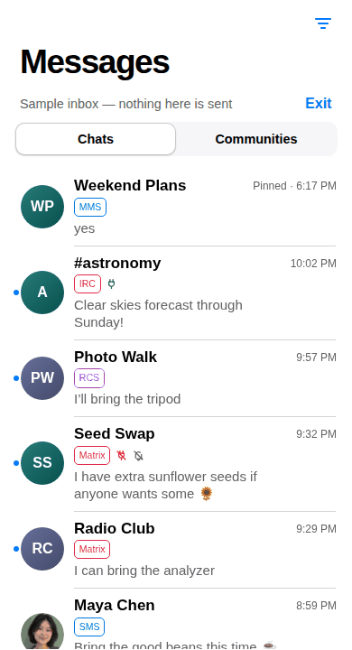<br><sub>On a phone-sized screen. Real capture with made-up names.</sub></td>
</tr></table>

| Your device | How you use FluidMessages | Chat services | Texting with your phone number |
|---|---|:---:|:---:|
| 🤖 Android phone | Install the app | ✅ | ✅ |
| 🪟 Windows, 🍎 Mac, 🐧 Linux | Install the computer app | ✅ | ✅ if you link an Android phone (takes some setup) |
| 📱 iPhone, iPad | Open it in your browser from a computer that runs FluidMessages, then add it to your home screen | ✅ | ✅ if you link an Android phone (takes some setup) |

<br>

# No internet? Use Nearby

<p align="center">
  
</p>

When the power is out, the cell towers are down, or the Wi-Fi has no internet, **Nearby** still lets you message FluidMessages friends close by. It works over Bluetooth or the same Wi-Fi, with no internet and no cell signal. It's good for blackouts, big events, camping, and school or office Wi-Fi that won't go online.

- **See who's close by.** People with Nearby on show up in the app. Tap someone to chat.
- **Locked between you two.** Only you and your friend can read your messages.
- **Phones help carry messages.** Other phones nearby can pass a message along, so it can reach someone a bit farther away, a little later. They can't read it.
- **Community channels.** Open rooms, like “Neighborhood”, for everyone close by.

Nearby can't reach people far away with no phones in between, and it can't make calls. It's on the Android app only, and it's off until you turn it on.

Read **[Staying in touch without internet](docs/offline-guide.md)** to see what still works when the internet or the cell network is down, and what to set up before you need it.

<br>

---

<br>

# Privacy you can see

<p align="center">
  
</p>

Every chat shows a small lock in one of three colors:

- **Green lock: locked.** Only you and the person you're talking to can read it. Nobody in between can, not even the company that carries it.
- **Yellow lock: locked on the way.** It is sealed while it travels, but the company or server that runs the service could open it and read it. Email and IRC usually get yellow.
- **Red open lock: not locked.** Anyone who carries it could read it, like a postcard. **Plain texting (SMS) gets red**, because your phone carrier can read every text.

The one exception for texts: if you and a friend both use FluidMessages, you can lock your texts to each other, and they turn green.

Tap a chat's details to see its lock explained in words:

<p align="center">
  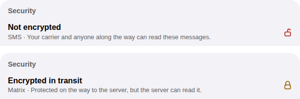
  <br><sub>Real capture with made-up names.</sub>
</p>

<p align="center">
  
</p>

- **App lock:** opens only with your fingerprint or code.
- **Hidden folder:** private chats vanish from your inbox until you unlock them.
- **Decoy code:** a second code opens a harmless pretend inbox, for when someone makes you unlock your phone.
- **Emergency erase:** a special code quietly wipes everything.
- **Disappearing messages:** messages delete themselves after an hour, a day, or a week.

<br>

# Never lose a text again

<p align="center">
  
</p>

Phones break. Phones get lost. With most texting apps, your messages go with them.

FluidMessages saves your texts, photos, and settings in a **backup locked with your password**. You pick where it goes: your phone, your own computer, or a cloud like Google Drive. Set it once and it backs up on its own. Get a new phone, and everything comes back.

<br>

# Text from your computer

<p align="center">
  
</p>

Typing on a phone is slow. Link your Android phone to FluidMessages on your computer, and your texts show up there too. Read a message on one, and it is marked read on both.

> [!NOTE]
> **Linking takes some setup today.** It is not one tap yet. FluidMessages has to run on a computer at home with a secure web address, and the app's guide walks you through it. If that sounds like too much, the phone app works great on its own.

<br>

# And a lot more

- ✏️ **Fix a typo** after you send.
- 🤫 **Hidden messages** that stay blurry until your friend taps.
- 🖼️ **Photo editor** with crop, filters, drawing, and stickers.
- 🎙️ **Voice messages.**
- 🔕 **Mute a chat** for an hour, a day, or for good.
- 🚫 **Spam and unknown senders** kept out of your way.

<details>
<summary><b>📸 See real screenshots</b></summary>
<br>
<p align="center">
  
  <br><br>
  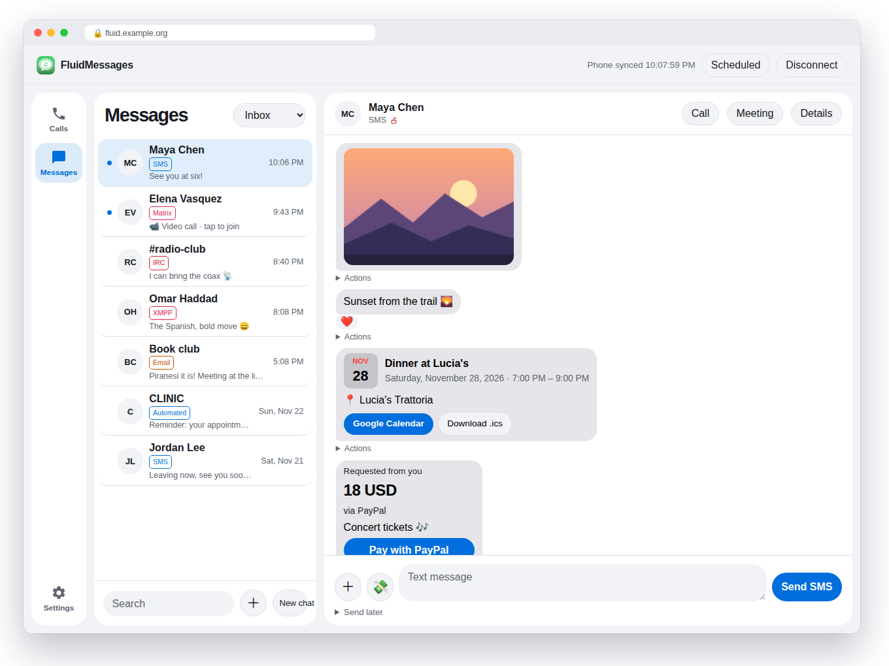
  <br><br>
  
</p>
<sub>Android screens are illustrations. Computer screenshots are real captures. Everything uses made-up names.</sub>
</details>

[See everything it can do →](docs/features.md)

<br>

---

<br>

# Get it

Free. No account. No ads. Pick your device to see the ways to install it.

<p align="center">
  <a href="#android"></a>
  <a href="#windows"></a>
  <a href="#mac"></a>
  <a href="#linux"></a>
  <a href="#iphone-and-ipad"></a>
</p>

## Android

For Android 13 or newer. Pick one:

<p align="center">
  <a href="https://github.com/Lin8x/FluidMessages/releases/latest/download/FluidMessages.apk"></a>
  <a href="https://apps.obtainium.imranr.dev/redirect?r=obtainium://app/%7B%22id%22%3A%22org.fluidmessages%22%2C%22url%22%3A%22https%3A%2F%2Fgithub.com%2FLin8x%2FFluidMessages%22%2C%22author%22%3A%22Lin8x%22%2C%22name%22%3A%22FluidMessages%22%2C%22additionalSettings%22%3A%22%7B%5C%22apkFilterRegEx%5C%22%3A%5C%22%5EFluidMessages-%5B0-9.%5D%2B%5C%5C%5C%5C.apk%24%5C%22%7D%22%7D"></a>
</p>

- **From GitHub:** download `FluidMessages.apk` on your phone, open it, and tap **Install**. If your phone asks, allow installs from your browser. FluidMessages checks for updates itself in **Settings → About and updates**.
- **With Obtainium:** Obtainium installs FluidMessages from GitHub and keeps it up to date for you. With Obtainium on your phone, tap **Get it on Obtainium**. That button opens a page on Obtainium's own website, which has ads and analytics. To skip it, open Obtainium, tap **Add app**, paste `https://github.com/Lin8x/FluidMessages`, and set **Filter APKs by regular expression** to `^FluidMessages-[0-9.]+\.apk$`.

Then the app helps you make it your texting app. You can switch back any time.

- On Android 15, if that last step is blocked: **Settings → Apps → FluidMessages → ⋮ → Allow restricted settings**.
- Coming from an iPhone? Turn off iMessage on it first (**Settings → Apps → Messages**), or texts from iPhone friends can get lost.

## Windows

For Windows 10 or 11. Pick one:

<p align="center">
  <a href="https://github.com/Lin8x/FluidMessages/releases/latest/download/FluidMessages-Web-Windows.exe"></a>
  <a href="#windows-command"></a>
</p>

- **From GitHub:** download `FluidMessages-Web-Windows.exe` and open it. Windows may warn you the first time. [Here's what to do.](docs/self-hosting.md#desktop-apps)
- <a id="windows-command"></a>**With one command:** open PowerShell and paste this. It checks the download first, puts FluidMessages Web in your Start menu, and needs no administrator. Run it again to update.

  ```powershell
  irm https://raw.githubusercontent.com/Lin8x/FluidMessages/main/install.ps1 | iex
  ```

  To remove it: `& ([scriptblock]::Create((irm https://raw.githubusercontent.com/Lin8x/FluidMessages/main/install.ps1))) -Uninstall`
- **Microsoft Store:** coming soon.

## Mac

For Macs with Apple silicon (M1 or newer). Pick one:

<p align="center">
  <a href="https://github.com/Lin8x/FluidMessages/releases/latest/download/FluidMessages-Web-macOS.dmg"></a>
  <a href="#homebrew"></a>
  <a href="#mac-command"></a>
</p>

- **From GitHub:** download `FluidMessages-Web-macOS.dmg`, open it, and drag **FluidMessages Web** to **Applications**. Your Mac may warn you the first time. [Here's what to do.](docs/self-hosting.md#desktop-apps)
- <a id="homebrew"></a>**With Homebrew:** open Terminal and paste this:

  ```bash
  brew install --cask lin8x/tap/fluidmessages-web
  ```

  To update: `brew upgrade --cask fluidmessages-web`. To remove it: `brew uninstall --cask fluidmessages-web`.
- <a id="mac-command"></a>**With one command:** open Terminal and paste this. It checks the download first and installs the app in Applications. Run it again to update.

  ```bash
  curl -fsSL https://raw.githubusercontent.com/Lin8x/FluidMessages/main/install.sh | bash
  ```

  To remove it, add `-s -- --uninstall` after `bash`.

## Linux

For 64-bit PCs (x86_64). Pick one:

<p align="center">
  <a href="https://github.com/Lin8x/FluidMessages/releases/latest/download/FluidMessages-Web-Linux-amd64.deb"></a>
  <a href="https://github.com/Lin8x/FluidMessages/releases/latest/download/FluidMessages-Web-Linux-x86_64.rpm"></a>
  <a href="https://github.com/Lin8x/FluidMessages/releases/latest/download/FluidMessages-Web-Linux-x86_64.AppImage"></a>
  <a href="#linux-command"></a>
</p>

- **From GitHub:** download the file for your system:
  - **Debian or Ubuntu** (22.04 and newer): [`FluidMessages-Web-Linux-amd64.deb`](https://github.com/Lin8x/FluidMessages/releases/latest/download/FluidMessages-Web-Linux-amd64.deb), then `sudo apt install ./FluidMessages-Web-Linux-amd64.deb`
  - **Fedora or openSUSE:** [`FluidMessages-Web-Linux-x86_64.rpm`](https://github.com/Lin8x/FluidMessages/releases/latest/download/FluidMessages-Web-Linux-x86_64.rpm), then `sudo dnf install ./FluidMessages-Web-Linux-x86_64.rpm` (or `sudo zypper install` on openSUSE)
  - **Any other Linux:** [`FluidMessages-Web-Linux-x86_64.AppImage`](https://github.com/Lin8x/FluidMessages/releases/latest/download/FluidMessages-Web-Linux-x86_64.AppImage). Allow it to run (right-click → **Properties → Allow executing**, or `chmod +x` it), and open it.
- <a id="linux-command"></a>**With one command:** paste this in a terminal. It checks the download first, adds FluidMessages Web to your app menu, and needs no sudo. Run it again to update.

  ```bash
  curl -fsSL https://raw.githubusercontent.com/Lin8x/FluidMessages/main/install.sh | bash
  ```

  To remove it, add `-s -- --uninstall` after `bash`.

On a computer, link your Android phone in **Settings → Phone and other devices** to see your texts there too.

## iPhone and iPad

Run FluidMessages on a computer at home, open its address in Safari, and tap **Share → Add to Home Screen**. Alerts only come while it is open.

## Check your download

Make sure your copy is the real one and nobody changed it. On Android, open **Settings → About and updates** and look for "Matches the official FluidMessages key". [How to check any download](docs/verify.md).

<br>

---

<br>

# A note from the person who made this

I'm one person, not a company.

I made FluidMessages because I was tired of it. Tired of being the green bubble. Tired of a phone maker deciding how I talk to my friends. I looked for an app that fixed texting, kept my messages private, and worked on all my devices. I could not find one. So I built it.

**I used AI tools to help write the code**, and I want to be upfront about that. Here is why I think you can still trust it: every line is public. You don't have to take my word for anything. Anyone can read the code, test it, and tell me what is wrong, and I will fix it.

There are no ads here and nothing to buy. I just think your messages should belong to you. ([Privacy policy](docs/privacy.md))

<br>

---

<br>

## For tech-savvy folks

<details>
<summary><b>🏠 Run it yourself (self-hosting)</b></summary>
<br>

Run FluidMessages Web on your own machine or home server and open it from any device's browser. It works on its own for Matrix, XMPP, Email, and IRC, and a linked Android phone adds your texts. It runs anywhere Docker does, even a Raspberry Pi.

```sh
docker compose up -d
```

Open <http://localhost:8080>. On that computer it opens straight into a short welcome, with no password or code.

To use it from other devices or link your phone, open **Settings → Phone and other devices**. It walks you through setting a password and connecting your Android phone. Other devices need it served over HTTPS; the guide covers that.

Also available: the [server download](https://github.com/Lin8x/FluidMessages/releases/latest/download/FluidMessages-Server.zip) and the Docker image `ghcr.io/lin8x/fluidmessages-web`.

[Full self-hosting guide →](docs/self-hosting.md) (HTTPS, Portainer, linking your phone, and installing it as an app)

</details>

<details>
<summary><b>📚 Docs</b></summary>
<br>

| | |
|---|---|
| 📖 [Features](docs/features.md) | Everything the app can do. |
| 🏠 [Self-hosting](docs/self-hosting.md) | Docker, Portainer, HTTPS, and desktop apps. |
| 🧱 [Build from source](docs/building.md) | Command-line build steps for the app and FluidMessages Web. |
| 🛠️ [Development](docs/development.md) | Testing and releasing. |
| 🤝 [Contributing](CONTRIBUTING.md) | How to help. |
| 🛡️ [Privacy policy](docs/privacy.md) | What the app sends, and where. |
| 🔐 [Security](SECURITY.md) | Report a problem privately. |

Built with      

</details>

<details>
<summary><b>🤝 Contributing</b></summary>
<br>

Everyone is welcome, and you don't have to write code to help.

| | |
|---|---|
| 🐛 **Report a bug** | [Open an issue](https://github.com/Lin8x/FluidMessages/issues/new) with what you did and what happened. |
| 💡 **Suggest an idea** | [Open an issue](https://github.com/Lin8x/FluidMessages/issues/new) and tell us what you'd like. |
| 📱 **Test on your phone** | Try new releases and tell us what works on your phone and carrier. |
| 🧑‍💻 **Write code** | Fix a bug or build a feature, then open a pull request. |

**Code in four steps:**

1. Fork the repo and clone it.
2. Build the app: `./gradlew assembleDebug` (needs JDK 17 and Android SDK 35).
3. Run the checks: `./scripts/test-local`.
4. Open a pull request. For screen changes, add a screenshot.

Please use made-up names and messages in screenshots and tests. Read [CONTRIBUTING.md](CONTRIBUTING.md) for the full guide.

</details>

<br>

## License

FluidMessages is free and open source under the [Apache License 2.0](LICENSE).

<div align="center">
<br>
<br>
<sub>Made with 💚 for everyone tired of the walls.</sub>
</div>
